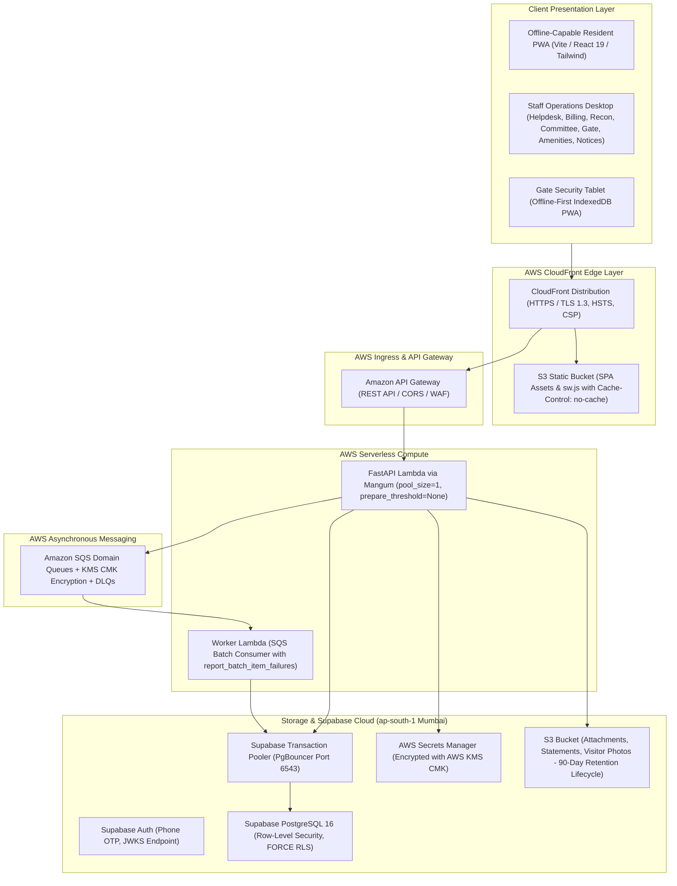

# Township Operations Platform — Production Deployment Guide
**Target System**: Gated Township Operations (Pune, Maharashtra — 2,400 Apartments, 28 Towers, 180 Staff)  
**Deliverable**: Phase 8 Complete (Official Township Notices & Full System Hardening)

---

## 1. System Architecture & Topology

The platform is designed as a cloud-native, serverless, multi-tenant township management system adhering to strict SOC 2 financial governance, tenant isolation, and high availability using **Option B: Supabase Auth & PostgreSQL + AWS Serverless Lambda**.



---

## 2. Prerequisites & Environment Setup

### 2.1 Required Toolchains
- **Python**: `3.11+` (Required for FastAPI backend and AWS CDK infrastructure)
- **Node.js**: `20.x` or `22.x` LTS with `npm 10+`
- **AWS CLI**: `v2.x` configured with deployment IAM credentials (`AdministratorAccess` or scoped CDK role)
- **AWS CDK CLI**: `npm install -g aws-cdk@^2.100.0`
- **PostgreSQL Client**: `psql` (libpq 16+)

### 2.2 Repository Checkout
All deployment commands assume `REPO_ROOT` is set to the cloned repository root:
```bash
git clone https://github.com/Bhaumik-99/isoswe.git
cd isoswe
export REPO_ROOT="$(pwd)"
```

---

## 3. Environment Variables & Secrets Management

The platform adheres to 12-factor configuration. In `staging` and `production`, secrets **must never** be committed to source control and are retrieved from AWS Secrets Manager.

### 3.1 Backend Configuration (`services/api/.env`)

```ini
# Core Environment
ENVIRONMENT=production
DEBUG=false
TZ=Asia/Kolkata

# Multi-Tenant Database (Supabase Transaction Pooler via PgBouncer port 6543)
DATABASE_URL=postgresql+psycopg://postgres.<project-ref>:<SECRET_PASSWORD>@aws-0-ap-south-1.pooler.supabase.com:6543/postgres?sslmode=require
DB_POOL_SIZE=1
DB_MAX_OVERFLOW=0
DB_POOL_TIMEOUT=30

# Authentication & Supabase
SUPABASE_URL=https://<project-id>.supabase.co
SUPABASE_JWT_SECRET=<MIN_32_CHAR_HMAC_OR_ED25519_SECRET>
SUPABASE_SERVICE_ROLE_KEY=<SUPABASE_SERVICE_ROLE_KEY>
ENABLE_LOCAL_AUTH_BYPASS=false

# CORS & Trusted Origins
ALLOWED_ORIGINS=["https://township.example.com", "https://d1234abcd.cloudfront.net"]

# Outbox & Reliability
MESSAGING_PROVIDER=sqs
SQS_OUTBOX_QUEUE_URL=https://sqs.ap-south-1.amazonaws.com/123456789012/township-billing-jobs-prod
EVENT_RETRY_MAX_ATTEMPTS=5
```

### 3.2 Frontend Build Configuration (`apps/web/.env.production`)

```ini
VITE_API_BASE_URL=https://api.township.example.com
VITE_SUPABASE_URL=https://<project-id>.supabase.co
VITE_SUPABASE_ANON_KEY=<SUPABASE_PUBLIC_ANON_KEY>
```

### 3.3 AWS Secrets Manager Provisioning & Guest-Pass HMAC Secret

In staging and production, secrets are managed centrally in AWS Secrets Manager under secret name `township-supabase-credentials-<env>` (e.g., `township-supabase-credentials-prod`), encrypted with the stack's Customer Managed KMS Key (CMK).

#### Automated Secret Generation via AWS CDK
The CDK `SecurityConstruct` (`infra/cdk/township_constructs/security.py`) automatically provisions the secret JSON with:
1. `GUEST_PASS_HMAC_SECRET`: Automatically generated 64-character high-entropy cryptographic secret via `SecretStringGenerator(password_length=64)`. This strictly satisfies the platform invariant requiring `>= 32` characters in staging/production, eliminating runtime HTTP 500 errors.
2. `DATABASE_URL` & `SUPABASE_URL`: Initialized in the JSON template for operator configuration.

#### Operator Configuration & Secrets Population Command
After CDK stack deployment, administrators populate the live connection strings using the AWS CLI:

```bash
# Retrieve existing generated secret or generate a fresh 64-character secret
EXISTING_HMAC=$(aws secretsmanager get-secret-value \
  --secret-id "township-supabase-credentials-prod" \
  --region ap-south-1 \
  --query "SecretString" --output text 2>/dev/null | jq -r '.GUEST_PASS_HMAC_SECRET // empty')

if [ -z "$EXISTING_HMAC" ]; then
  EXISTING_HMAC=$(openssl rand -hex 32)
fi

# Update Secrets Manager with live credentials while preserving GUEST_PASS_HMAC_SECRET
aws secretsmanager put-secret-value \
  --secret-id "township-supabase-credentials-prod" \
  --region ap-south-1 \
  --secret-string "{
    \"DATABASE_URL\": \"$LIVE_DATABASE_URL\",
    \"SUPABASE_URL\": \"$LIVE_SUPABASE_URL\",
    \"GUEST_PASS_HMAC_SECRET\": \"$EXISTING_HMAC\"
  }"
```

---

## 4. Database Provisioning & Migrations

The database utilizes **Supabase PostgreSQL 16** (Mumbai `ap-south-1`) with **Row Level Security (RLS)** strictly enforced on all financial, tenant, and amenity tables.

### 4.1 Execute Alembic Migrations
Run Alembic migrations up to head to create tables, triggers, indexes, and RLS policies:

```bash
cd "$REPO_ROOT/services/api"
python -m venv .venv
source .venv/bin/activate  # Or on Windows: .venv\Scripts\activate
pip install -r requirements.txt

# Run migrations to head (018_official_township_notices)
python -m alembic upgrade head
cd "$REPO_ROOT"
```

### 4.2 Seed Baseline Demographics & Society Data
From the repository root, seed the Pune township baseline data (Marvel Greenfield Residences: 28 Towers, 2,400 Flats, 180 Staff, Amenities, Notices, and Sample Ledger):

```bash
cd "$REPO_ROOT"
PYTHONPATH=services/api python scripts/seed.py

# Populate full target-scale township population (28 towers, 2,400 flats, 180 staff)
PYTHONPATH=services/api python scripts/generate_sample_data.py
```

### 4.3 Database Verification Commands
```sql
-- Verify FORCE ROW LEVEL SECURITY on critical tables
SELECT tablename, rowsecurity FROM pg_tables 
WHERE schemaname = 'public' 
AND tablename IN ('societies', 'flats', 'invoices', 'payments', 'financial_ledger_entries', 'bank_transactions', 'user_permissions', 'amenities', 'amenity_bookings', 'notices');

-- Confirm all migrations applied cleanly up to 018
SELECT version_num FROM alembic_version;
-- Expected: 018_official_township_notices
```

---

## 5. Infrastructure as Code (AWS CDK) Deployment

The infrastructure is defined under `infra/cdk` in AWS Region `ap-south-1` (Mumbai).

```bash
cd "$REPO_ROOT/infra/cdk"
python -m venv .venv
source .venv/bin/activate
pip install -r requirements.txt

# Synthesize CloudFormation templates (valid env values: dev, staging, prod)
cdk synth -c env=prod

# Bootstrap CDK environment (first-time deployment only)
cdk bootstrap aws://123456789012/ap-south-1

# Deploy TownshipOps-Prod stack
cdk deploy --all -c env=prod --require-approval never
cd "$REPO_ROOT"
```

The CDK constructs provision:
1. **SecurityConstruct**: KMS Customer Managed Keys (CMK) and AWS Secrets Manager secret (`township-supabase-credentials-prod`) with auto-generated 64-char `GUEST_PASS_HMAC_SECRET`.
2. **StorageConstruct**: Private S3 Document & Visitor Photo bucket with KMS encryption, automated 90-day expiration lifecycle for visitor photos, and CORS configuration.
3. **MessagingConstruct**: 5 Amazon SQS queues (`billing-jobs`, `payment-events`, `reconciliation-jobs`, `complaint-ai-jobs`, `notification-jobs`) with KMS encryption and paired Dead Letter Queues (DLQs).
4. **ComputeConstruct**: FastAPI Lambda function via Mangum with direct TLS connectivity to Supabase PgBouncer (eliminating NAT Gateways), and SQS Worker Lambda with `report_batch_item_failures`.
5. **ApiGatewayConstruct**: Amazon API Gateway REST API with CORS headers, WAF rate limiting, and API keys.
6. **FrontendStack**: Amazon S3 bucket for SPA assets with CloudFront Origin Access Control (OAC), TLS 1.3, and security headers.

---

## 6. Frontend Build & Static Deployment

The frontend Progressive Web Application (PWA) is built and uploaded to Amazon S3:

```bash
cd "$REPO_ROOT/apps/web"
npm ci

# Run ESLint and Vitest unit test suite
npm run lint
npm test -- --run

# Compile TypeScript and Vite production bundle
npm run build

# Synchronize assets to S3
aws s3 sync dist/ s3://township-ops-frontend-prod/ --delete \
  --cache-control "public, max-age=31536000, immutable" \
  --exclude "index.html" \
  --exclude "sw.js" \
  --exclude "manifest.webmanifest"

# Upload entry files with strict cache revalidation
aws s3 cp dist/index.html s3://township-ops-frontend-prod/index.html \
  --cache-control "no-cache, no-store, must-revalidate"
aws s3 cp dist/sw.js s3://township-ops-frontend-prod/sw.js \
  --cache-control "no-cache, no-store, must-revalidate"
aws s3 cp dist/manifest.webmanifest s3://township-ops-frontend-prod/manifest.webmanifest \
  --cache-control "no-cache, no-store, must-revalidate"

# Invalidate CloudFront edge cache
aws cloudfront create-invalidation \
  --distribution-id E12345EXAMPLE \
  --paths "/*"
cd "$REPO_ROOT"
```

---

## 7. Health Checks, Verification & Monitoring

### 7.1 Health Check Endpoints
- **Liveness Probe**: `GET https://api.township.example.com/health` (Returns HTTP 200 `{ "status": "healthy" }`)
- **Readiness Probe**: `GET https://api.township.example.com/health/ready` (Verifies Supabase PostgreSQL connection pool, SQS connectivity, and cache availability)

### 7.2 CloudWatch Metrics & Alarms
- **Lambda Duration**: Alarm if API Lambda duration `p95 > 1000ms` for 3 consecutive evaluation periods.
- **5xx HTTP Errors**: Alarm if API Gateway `5XXError > 5` over a 5-minute period.
- **Dead Letter Queue (DLQ)**: Alarm if `ApproximateNumberOfMessagesVisible > 0` on any of the 5 DLQ queues.

---

## 8. Rollback & Disaster Recovery Procedures

### 8.1 Serverless Application Rollback
If an application defect is detected post-deployment:
```bash
# Roll back API Lambda to previous published version / alias
aws lambda update-alias \
  --function-name township-api-prod \
  --name live \
  --function-version <PREVIOUS_VERSION_NUMBER>
```

### 8.2 Database Rollback Strategy
Database migrations are written with clean, reversible `downgrade()` routines:
```bash
cd "$REPO_ROOT/services/api"
# Revert the latest migration
python -m alembic downgrade -1
cd "$REPO_ROOT"
```

For major state recovery:
- Supabase Point-in-Time Recovery (PITR) is enabled with continuous WAL archiving.
- Daily automated snapshots and pre-deployment backups are maintained.
