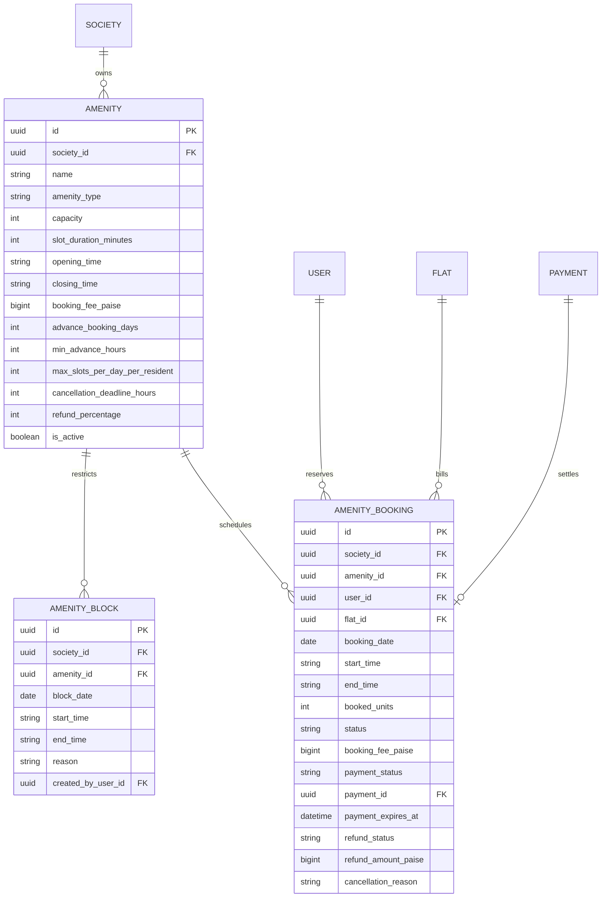
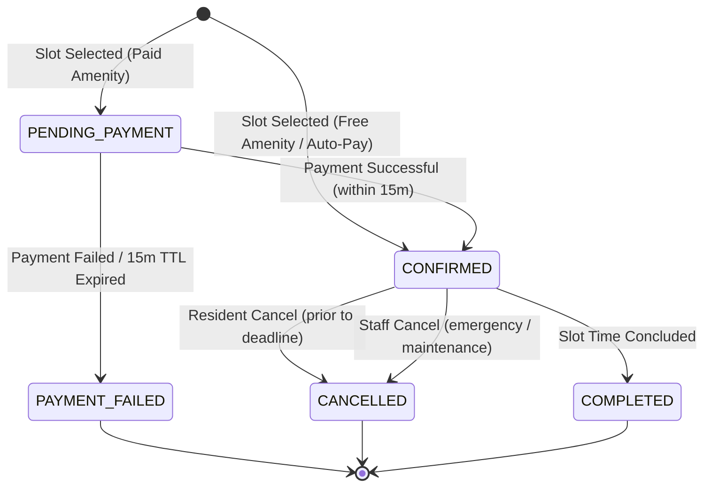
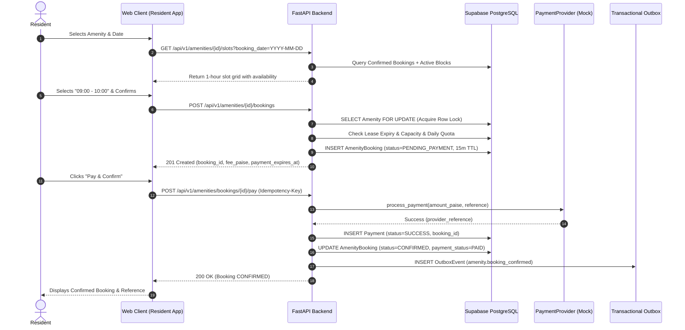
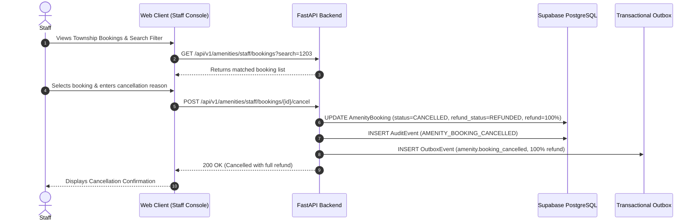

# Township Amenities & Clubhouse Booking — Technical Design & Operational Guide

## 1. Executive Summary & Problem Context

The **Township Operations Platform** manages Marvel Greenfield Residences (2,400 apartments across 28 residential towers, 180 facility-management staff in Pune, India).

Township residents require shared access to scarce, high-demand communal facilities:
- Central Clubhouse Lounge & Resident Activity Center
- Teakwood Indoor Badminton Courts
- Floodlit Synthetic Tennis Courts
- Grand Community Banquet Hall
- Olympic Swimming Pool & Fitness Gymnasium

Prior to Phase 8, amenities lacked a centralized reservation engine, causing slot overbooking, verbal disputes, hoarding by individual flats, and opaque manual cash collection. Phase 8 introduces an end-to-end, concurrency-safe, multi-tenant amenity booking and operational management system.

---

## 2. Architecture & Domain Entity Model



---

## 3. Booking & Payment Lifecycle State Machines

### 3.1 Booking Status Lifecycle


### 3.2 Payment Status Lifecycle
- `PENDING`: Payment initiated; 15-minute expiration timer active (`payment_expires_at`).
- `PAID`: Payment confirmed via provider; payment record persisted; booking confirmed.
- `FAILED`: Payment declined or window expired; slot unlocked.
- `REFUNDED`: Booking cancelled; calculated refund credited according to policy.

---

## 4. End-to-End Sequence Diagrams

### 4.1 Complete Resident Booking & Payment Flow


### 4.2 Staff Cancellation & Full Refund Flow


---

## 5. Concurrency Control & Fair Usage Protection

### 5.1 Row-Level Serialization (`SELECT ... FOR UPDATE`)
When two residents simultaneously attempt to book the last available unit of a slot (e.g. capacity = 1 on Badminton Court 1):
1. The first incoming request acquires the row-level lock on the `Amenity` row in PostgreSQL.
2. The database transaction tallies current confirmed bookings and active unexpired pending bookings for that specific date and time.
3. If `remaining_capacity >= requested_units`, the booking is recorded and the transaction commits.
4. The competing concurrent transaction, upon acquiring the released lock, evaluates `remaining_capacity == 0` and immediately raises `ConflictError(code="CAPACITY_EXCEEDED")`, returning HTTP 409.
5. Invariant: Under zero circumstances can total booked units exceed configured capacity.

### 5.2 Fair Usage Daily Limits
- `max_slots_per_day_per_resident`: Restricts excessive reservations by a single flat/resident (e.g., maximum 2 hours per day on Badminton Courts).
- Prevents commercial coaching exploitation or monopolization of communal township facilities.

### 5.3 Lease Expiry Protection
- For tenant residents, `FlatMembership.lease_end_date` is checked against the target `booking_date`.
- If a tenant's lease expires prior to the booking date, the reservation is rejected with `403 FORBIDDEN` (`TENANT_LEASE_EXPIRED`).

---

## 6. API Endpoint Catalog & Error Codes

### 6.1 Resident Endpoints (`/api/v1/amenities`)
| Method | Endpoint | Description | Auth Required |
| :--- | :--- | :--- | :--- |
| `GET` | `/api/v1/amenities` | List active amenities with optional type filter | Resident / Staff |
| `GET` | `/api/v1/amenities/{id}` | Retrieve amenity details, operating hours, fees | Resident / Staff |
| `GET` | `/api/v1/amenities/{id}/slots` | Retrieve slot grid and availability for date | Resident / Staff |
| `POST` | `/api/v1/amenities/{id}/bookings` | Create new slot booking (pending or auto-pay) | Resident |
| `GET` | `/api/v1/amenities/bookings/me` | List authenticated resident's bookings | Resident |
| `GET` | `/api/v1/amenities/bookings/{id}` | Get single booking details (IDOR protected) | Resident |
| `POST` | `/api/v1/amenities/bookings/{id}/pay` | Pay for pending booking with Idempotency-Key | Resident |
| `POST` | `/api/v1/amenities/bookings/{id}/cancel` | Cancel booking (self-service refund rules) | Resident |

### 6.2 Staff Endpoints (`/api/v1/amenities/staff`)
| Method | Endpoint | Description | Auth Required |
| :--- | :--- | :--- | :--- |
| `POST` | `/api/v1/amenities/staff` | Create new facility/amenity configuration | Staff (Helpdesk) |
| `PATCH` | `/api/v1/amenities/staff/{id}` | Update fees, rules, or operational hours | Staff (Helpdesk) |
| `POST` | `/api/v1/amenities/staff/{id}/status` | Activate or deactivate amenity | Staff (Helpdesk) |
| `GET` | `/api/v1/amenities/staff/bookings` | Search and filter all township bookings | Staff (Helpdesk) |
| `POST` | `/api/v1/amenities/staff/bookings/{id}/cancel` | Emergency cancellation with 100% refund | Staff (Helpdesk) |
| `POST` | `/api/v1/amenities/staff/{id}/blocks` | Create maintenance/private block | Staff (Helpdesk) |
| `GET` | `/api/v1/amenities/staff/{id}/blocks` | List maintenance blocks for amenity | Staff (Helpdesk) |
| `DELETE` | `/api/v1/amenities/staff/blocks/{id}` | Delete maintenance block (unblock slot) | Staff (Helpdesk) |

### 6.3 Application Error Code Catalog
| Error Code | HTTP Status | Meaning |
| :--- | :--- | :--- |
| `AMENITY_NOT_FOUND` | 404 | Amenity ID does not exist or belongs to another society |
| `AMENITY_INACTIVE` | 400 | Amenity is temporarily disabled by management committee |
| `OUTSIDE_OPERATING_HOURS` | 400 | Selected start/end time falls outside daily hours |
| `INVALID_SLOT_DURATION` | 400 | Selected duration is not an exact multiple of slot duration |
| `PAST_DATE_NOT_ALLOWED` | 400 | Cannot book slots in the past |
| `ADVANCE_BOOKING_LIMIT_EXCEEDED`| 400 | Booking date exceeds max advance booking window |
| `MIN_ADVANCE_TIME_NOT_MET` | 400 | Booking requested with insufficient advance lead time |
| `DAILY_LIMIT_EXCEEDED` | 409 | Resident has reached maximum allowed slots for that day |
| `CAPACITY_EXCEEDED` | 409 | Slot is fully booked by other residents |
| `DUPLICATE_BOOKING` | 409 | Resident already has an active booking for this exact slot |
| `SLOT_BLOCKED` | 409 | Slot is reserved for maintenance or private society event |
| `BOOKING_NOT_FOUND` | 404 | Booking ID not found or belongs to another user/tenant |
| `BOOKING_ACCESS_DENIED` | 403 | IDOR prevention: User does not own the target booking |
| `BOOKING_NOT_PENDING_PAYMENT` | 409 | Booking is already paid or cancelled |
| `PAYMENT_WINDOW_EXPIRED` | 400 | 15-minute payment hold has elapsed |
| `CANCELLATION_DEADLINE_EXPIRED` | 409 | Cancellation window has closed (resident self-service) |
| `CANNOT_CANCEL_COMPLETED_OR_FAILED`| 409 | Cannot cancel a completed or failed booking |

---

## 7. Sample Data & Idempotent Seeding

The platform includes 4 realistic, production-calibrated sample amenities in `scripts/seed.py`:

| Amenity Name | Type | Capacity | Duration | Hours | Fee | Advance |
| :--- | :--- | :--- | :--- | :--- | :--- | :--- |
| **Central Clubhouse Lounge** | `CLUBHOUSE` | 20 | 60 min | 07:00–22:00 | Free (₹0) | 7 days |
| **Badminton Court 1 (Indoor Wooden)** | `BADMINTON_COURT`| 1 | 60 min | 06:00–22:00 | ₹150 (15,000 paise) | 7 days |
| **Floodlit Tennis Court** | `TENNIS_COURT` | 1 | 60 min | 06:00–21:00 | ₹250 (25,000 paise) | 7 days |
| **Grand Community Hall** | `COMMUNITY_HALL`| 1 | 180 min | 09:00–21:00 | ₹5,000 (500,000 paise)| 30 days |

### Seeding Command
```bash
python scripts/seed.py
```
*Idempotency Guarantee*: The seed script checks for existing records using deterministic UUIDs. Running it repeatedly produces zero duplicate amenities, flats, or billing records.

---

## 8. Validation Matrix: Critical Scenarios (A through J)

| Scenario | Description | Validation Mechanism | Test File |
| :--- | :--- | :--- | :--- |
| **A** | Concurrency race condition on final slot | First succeeds; second receives `409 CAPACITY_EXCEEDED` | `test_amenity_booking_e2e_scenarios.py` |
| **B** | Booking inactive amenity | Fails with `400 AMENITY_INACTIVE` | `test_amenity_booking_e2e_scenarios.py` |
| **C** | Booking outside hours or misaligned duration | Fails with `OUTSIDE_OPERATING_HOURS` / `INVALID_SLOT_DURATION` | `test_amenity_booking_e2e_scenarios.py` |
| **D** | Booking maintenance-blocked slot | Fails with `409 SLOT_BLOCKED` | `test_amenity_booking_e2e_scenarios.py` |
| **E** | Cross-resident IDOR attack | Other resident gets `404 Not Found` / `403 Forbidden` | `test_amenity_booking_e2e_scenarios.py` |
| **F** | Duplicate payment callback / retry | Idempotent replay; returns cached response; no double charge | `test_amenity_booking_e2e_scenarios.py` |
| **G** | Abandoned or failed payment | Transitions to `PAYMENT_FAILED`; releases slot capacity | `test_amenity_booking_e2e_scenarios.py` |
| **H** | Cancellation past deadline | Resident self-service rejected with `409 CANCELLATION_DEADLINE_EXPIRED` | `test_amenity_booking_e2e_scenarios.py` |
| **I** | Staff updates fee while active bookings exist | Existing booking keeps historical fee; new booking uses new fee | `test_amenity_booking_e2e_scenarios.py` |
| **J** | Unauthorized resident calls staff endpoints | Strictly rejected with `403 Forbidden` across all endpoints | `test_amenity_booking_e2e_scenarios.py` |

---

## 9. Known Limitations & Operational Considerations

1. **Simulated Payment Provider in Test/Development**:
   - The platform integrates with `SimulatedPaymentProvider` to enable reliable testing and automated verification of financial state machines without external gateway flakiness.
   - **Operational Boundary**: Live payment gateway integration (e.g. Razorpay PG / Cashfree) requires registering credentials in AWS Secrets Manager and swapping the provider injection in `app/domains/amenities/service.py`. Real money movement must NOT be claimed until certified in a staging environment.
2. **Fixed Slot Steps**:
   - Slots are generated deterministically in multiples of `slot_duration_minutes` (e.g., 60-minute or 180-minute intervals). Custom continuous interval selection is not supported.
3. **Single-Day Banquet Bookings**:
   - Multi-day community hall rentals require reserving consecutive calendar days individually.

---

## 10. Staging Validation Checklist

Follow this checklist when deploying to an AWS staging environment:

- [ ] **Database Migration Execution**:
  - Run `alembic upgrade head`.
  - Confirm tables `amenities`, `amenity_bookings`, and `amenity_blocks` exist with appropriate RLS policies.
- [ ] **Seed Data Verification**:
  - Execute `python scripts/seed.py`.
  - Confirm 4 core amenities appear in the society database.
- [ ] **Resident Booking Journey**:
  - Log in as resident (e.g. Neeraj).
  - Open Amenities tab.
  - Verify Badmiton Court, Tennis Court, Clubhouse, and Community Hall display with correct pricing.
  - Select an open time slot and book.
  - Complete simulated test payment; verify status transitions to `CONFIRMED`.
  - Verify booking appears under "My Bookings" history.
- [ ] **Staff Console Verification**:
  - Log in as Helpdesk staff.
  - Open Staff Amenities dashboard.
  - Locate the resident booking under Bookings.
  - Place a 1-hour maintenance block on a future date.
  - Attempt to book that blocked slot as a resident; confirm UI indicates "Blocked for Maintenance".
- [ ] **Outbox Event Telemetry**:
  - Verify `outbox_events` table contains `amenity.booking_created` and `amenity.booking_confirmed` records.
  - Confirm SQS queue dispatches events to workers with zero DLQ poison pills.
