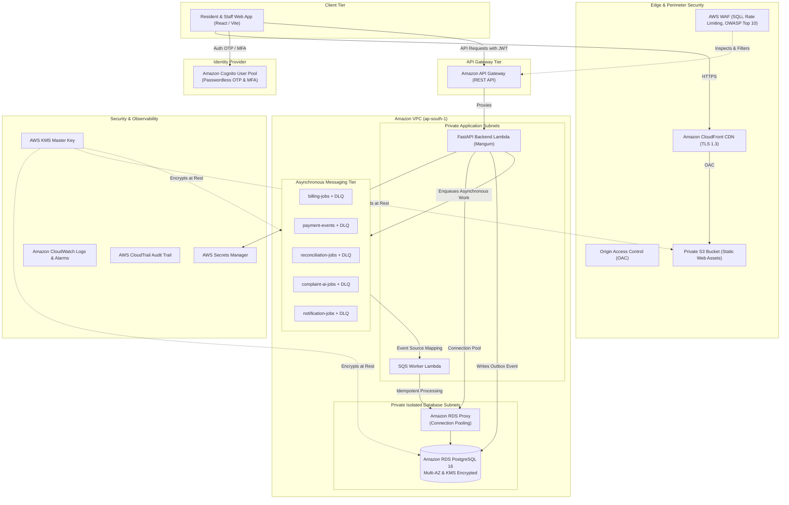
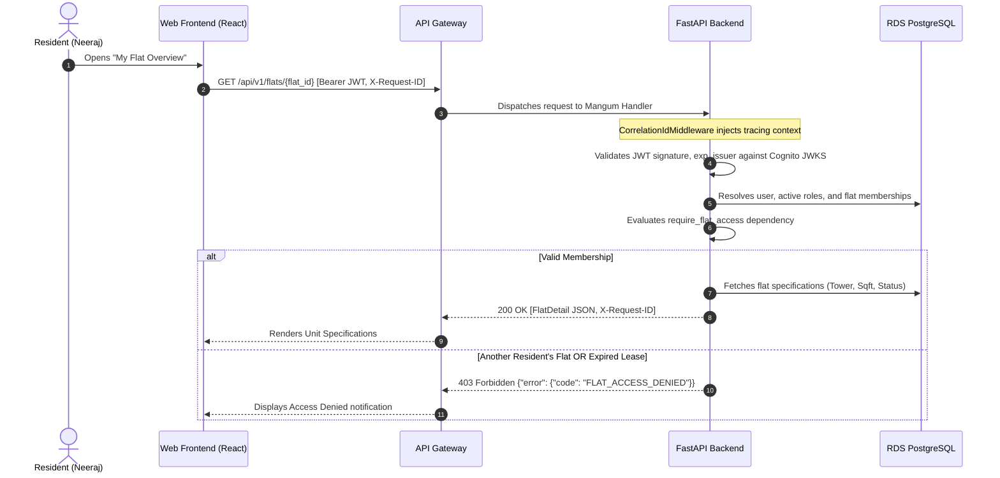
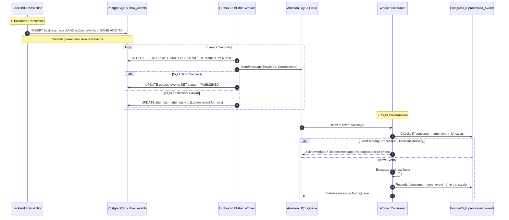

# Software and Cloud Infrastructure Architecture

## 1. Architectural Decisions (ADRs)

### ADR 001: Modular Monolith Architecture
- **Context**: The platform serves 2,400 flats, 28 towers, and 180 facility staff. Domain boundaries encompass Identity, Billing, Payments, Reconciliation, Complaints, and Reporting.
- **Decision**: Adopt a modular monolith rather than microservices. Domain logic is strictly partitioned into distinct Python modules (`app/domains/*`), interacting via explicit interfaces and domain services rather than distributed network calls.
- **Consequences**: Minimizes operational overhead, avoids distributed transaction failures across billing and ledger updates, simplifies local development, and allows frictionless serverless deployment via AWS Lambda and Mangum.

### ADR 002: Reliable Asynchronous Messaging via Transactional Outbox
- **Context**: Actions such as invoice generation, payment receipts, AI complaint processing, and SMS notifications require reliable execution without blocking HTTP responses or risking dual-write inconsistencies.
- **Decision**: Implement the Transactional Outbox pattern paired with Amazon SQS standard queues and dedicated Dead Letter Queues (DLQs). Business changes and outbox records commit within the exact same database transaction. An outbox worker dispatches events using `SELECT ... FOR UPDATE SKIP LOCKED`.
- **Consequences**: Guarantees zero lost messages if SQS or the network is temporarily degraded. Consumers use the `processed_events` registry for idempotent exactly-once processing.

### ADR 003: Multi-Tenant Data Isolation Strategy
- **Context**: While initial deployment is a single gated township in Pune (Marvel Greenfield Residences), cross-society leakage must be structurally prevented for future township federations.
- **Decision**: Enforce tenant boundaries through mandatory `society_id` foreign keys, composite database unique indexes, and backend FastAPI dependency barriers (`require_society_access`, `require_flat_access`). Never rely on client-side claims.
- **Consequences**: Prevents accidental data exposure across distinct societies and residential units.

### ADR 004: Strict Integer Paise Monetary Representation
- **Context**: Maintenance billing, sinking fund levies, and bank statement matching require financial precision.
- **Decision**: All financial amounts are stored as 64-bit BigInteger paise (1 INR = 100 paise). Floating-point data types (`FLOAT`, `REAL`, `DOUBLE PRECISION`) are prohibited in financial columns.
- **Consequences**: Eliminates IEEE 754 precision drift and rounding discrepancies in ledger audits.

---

## 2. AWS Target Architecture Diagram

---

## 3. Request Execution Flow (Synchronous API)

---

## 4. Transactional Outbox & Asynchronous Messaging Flow

