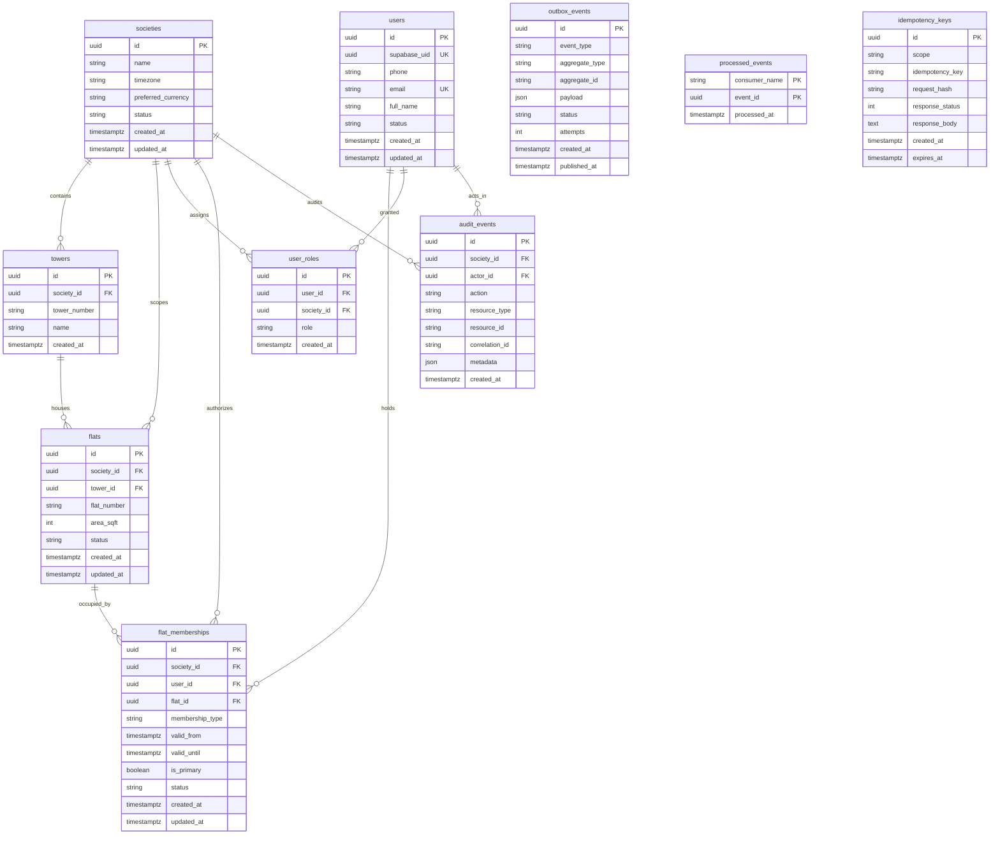

# Database Architecture & Schema Specification

## 1. System of Record Overview

The multi-tenant Society Operations Platform uses **Supabase PostgreSQL** (Mumbai `ap-south-1`) as its authoritative system of record.
- **Engine**: PostgreSQL 16 (hosted on Supabase)
- **Connection Endpoint**: Supabase Shared Transaction Pooler (PgBouncer port `6543`)
- **Driver**: Psycopg 3 (`psycopg[binary]>=3.1.18`)
- **ORM**: SQLAlchemy 2.0 with strict typing (`Mapped[...]`, `mapped_column`)
- **Schema Management**: Version-controlled Alembic migrations only (zero `create_all()` in production code)
- **Security & RLS**: PostgreSQL Row-Level Security (RLS) enabled on all core tables for defense-in-depth
- **Monetary Precision**: All monetary values are strictly represented in integer paise (e.g. ₹1,000.00 is stored as `100000`). Storing money in floating-point columns is strictly prohibited to eliminate IEEE 754 rounding errors.

---

## 2. Supabase Shared Transaction Pooler & Lambda Configuration

AWS Lambda instances connect to Supabase PostgreSQL using its shared transaction pooler:
```python
engine = create_engine(
    settings.DATABASE_URL,
    pool_size=1,
    max_overflow=0,
    pool_pre_ping=True,
    connect_args={
        "sslmode": "require",
        "prepare_threshold": None,  # Disables prepared statements for PgBouncer transaction mode
    },
)
```

### Critical Invariants:
1. **Disable Prepared Statements (`prepare_threshold: None`)**: PgBouncer in transaction pooling mode routes individual transactions across heterogeneous backend connections. Prepared statements must be disabled in Psycopg 3 to prevent "prepared statement does not exist" errors.
2. **Small Per-Lambda Pool (`pool_size=1, max_overflow=0`)**: Prevents connection exhaustion when multiple Lambda concurrent workers scale.
3. **Module-Scoped Engine**: Retained in global memory across warm Lambda invocations to eliminate connection handshake latency.
4. **Secrets Manager Storage**: The exact transaction pooler connection URI is stored securely in AWS Secrets Manager and encrypted with AWS KMS.

---

## 3. Entity Relationship Diagram (ERD)



---

## 4. Table Specifications & Constraints

### 4.1 Identity Domain

#### `societies`
- Root tenant anchor. All residential assets, billing ledgers, and access boundaries scope directly to a society.
- Columns: `id` (UUID PK), `name` (VARCHAR 255), `timezone` (VARCHAR 64, default 'Asia/Kolkata'), `preferred_currency` (VARCHAR 8, default 'INR'), `status` (ACTIVE, ONBOARDING, SUSPENDED), `created_at`, `updated_at`.

#### `towers`
- Tower buildings within a society (e.g. Tower 7, Tower 12, Tower 21).
- Composite Unique Constraint: `(society_id, tower_number)` prevents duplicate tower numbering within the same township.

#### `flats`
- Physical apartment units.
- Composite Unique Constraint: `(tower_id, flat_number)` guarantees unit number uniqueness per tower.
- Foreign Key with `ON DELETE CASCADE` to both `societies` and `towers`.

#### `users` (Application Profile Table)
- Application user profile table linked to `auth.users` via `supabase_uid`.
- Constraints: `supabase_uid` (UUID, UNIQUE, INDEXED), `phone` (VARCHAR 32, INDEXED), `email` (VARCHAR 255, NULLABLE, UNIQUE).
- Never modified directly by Supabase Auth; synced via application domain logic.

#### `flat_memberships`
- Links a user to a specific flat as an `OWNER`, `TENANT`, or `FAMILY_MEMBER`.
- Check Constraint: `valid_until IS NULL OR valid_until >= valid_from` ensures lease integrity.
- Compound Index: `(user_id, status)` for fast authorization lookup.

#### `user_roles`
- Granular RBAC assignments.
- Valid Roles: `RESIDENT` and `HELPDESK`.
- Unique Constraint: `(user_id, society_id, role)` prevents duplicate role assignments.

---

### 4.3 Billing Domain (Phase 2)

#### `billing_configurations`
- Society-level billing configuration parameters.
- Fields: `id` (UUID PK), `society_id` (UUID FK, UNIQUE), `rate_paise_per_sqft` (BIGINT, positive), `currency` (VARCHAR 8, default 'INR'), `due_day` (INTEGER, 1-28), `effective_from` (TIMESTAMPTZ), `created_at`, `updated_at`.

#### `invoices`
- Monthly apartment maintenance invoices.
- Fields: `id` (UUID PK), `society_id` (UUID FK), `flat_id` (UUID FK), `billing_period` (VARCHAR 7, 'YYYY-MM'), `invoice_number` (VARCHAR 64), `area_sqft_snapshot` (INTEGER), `rate_paise_per_sqft_snapshot` (BIGINT), `subtotal_paise` (BIGINT), `total_paise` (BIGINT), `due_date` (TIMESTAMPTZ), `status` (UNPAID, PARTIALLY_PAID, PAID, OVERDUE, VOID), `created_at`, `updated_at`.
- Unique Constraints:
  - `(society_id, flat_id, billing_period)` enforces at most 1 invoice per apartment per period.
  - `(society_id, invoice_number)` guarantees unique invoice numbers within the society.
- Check Constraints: `total_paise >= 0`, `subtotal_paise >= 0`, `area_sqft_snapshot > 0`, `rate_paise_per_sqft_snapshot > 0`.

#### `invoice_line_items`
- Itemized charges composing an invoice.
- Fields: `id` (UUID PK), `invoice_id` (UUID FK), `description` (VARCHAR 255), `quantity` (INTEGER, > 0), `unit_rate_paise` (BIGINT), `amount_paise` (BIGINT, >= 0), `created_at`.

#### `payments`
- Financial receipts and simulated payment transactions.
- Fields: `id` (UUID PK), `society_id` (UUID FK), `flat_id` (UUID FK), `amount_paise` (BIGINT, > 0), `currency` (VARCHAR 8), `provider` (VARCHAR 32, default 'SIMULATED'), `provider_reference` (VARCHAR 128), `status` (PENDING, SUCCESS, FAILED, REFUNDED), `initiated_by` (UUID FK), `created_at`, `updated_at`.
- Unique Constraint: `(provider, provider_reference)` guarantees duplicate payment reference prevention.

#### `payment_allocations`
- Explicit mapping of payment funds to invoices.
- Fields: `id` (UUID PK), `payment_id` (UUID FK), `invoice_id` (UUID FK), `allocated_paise` (BIGINT, > 0), `created_at`.
- Unique Constraint: `(payment_id, invoice_id)` prevents duplicate allocation of the same payment to an invoice.

#### `financial_ledger_entries`
- **Append-Only Journal**: Immutable financial ledger tracking all debits, credits, and balance changes.
- Invariant: Never edit or delete rows. Enforced at PostgreSQL database level via the `financial_ledger_immutable` trigger which raises an exception on any attempted `UPDATE` or `DELETE`. Corrections use explicit compensating reversal or adjustment entries referencing `reference_id`.
- Foreign Keys: `(society_id, flat_id)` references `flats(society_id, id)` with `ON DELETE RESTRICT` (preventing cascading deletion of historical financial records).
- Fields: `id` (UUID PK), `society_id` (UUID FK), `flat_id` (UUID FK), `invoice_id` (UUID FK, nullable), `payment_id` (UUID FK, nullable), `entry_type` (CHARGE, PAYMENT_RECEIVED, PAYMENT_ALLOCATED, REVERSAL, ADJUSTMENT), `amount_paise` (BIGINT, > 0), `reference_id` (VARCHAR 128, nullable), `description` (VARCHAR 255), `created_at`.

#### `billing_runs`
- Execution logs and metadata for society monthly billing generation.
- Fields: `id` (UUID PK), `society_id` (UUID FK), `billing_period` (VARCHAR 7), `total_eligible_flats` (INTEGER), `total_invoiced_flats` (INTEGER), `total_skipped_flats` (INTEGER), `total_charges_paise` (BIGINT), `status` (VARCHAR 32), `initiated_by` (UUID FK), `metadata` (JSON), `created_at`.

---

### 4.4 Bank Statement Reconciliation Domain (Phase 4)

#### `bank_statement_imports`
- Tracks uploaded CSV statement files, SHA-256 file checksums, detected/configured bank format profiles, parsing statistics, and processing status.
- Fields: `id` (UUID PK), `society_id` (UUID FK), `file_name` (VARCHAR 255), `file_checksum` (VARCHAR 64), `status` (StatementImportStatus), `bank_name` (VARCHAR 100, nullable), `account_number_mask` (VARCHAR 32, nullable), `uploaded_by` (UUID FK), `total_rows` (INTEGER), `valid_rows` (INTEGER), `rejected_rows` (INTEGER), `duplicate_rows` (INTEGER), `imported_rows` (INTEGER), `error_summary` (JSON), `created_at`, `updated_at`.
- Unique Invariant: `uq_bank_statement_imports_society_checksum` on `(society_id, file_checksum)` ensures no identical file can be ingested twice.

#### `bank_transactions`
- Normalized individual line items from imported bank statements with strictly integer paise monetary representation.
- Fields: `id` (UUID PK), `society_id` (UUID FK), `import_id` (UUID FK), `source_row_number` (INTEGER), `transaction_date` (DATE), `value_date` (DATE, nullable), `description` (VARCHAR 500), `normalized_description` (VARCHAR 500), `reference_number` (VARCHAR 100, nullable), `utr_number` (VARCHAR 100, nullable), `transaction_type` (CREDIT, DEBIT), `debit_paise` (BIGINT, default 0), `credit_paise` (BIGINT, default 0), `balance_paise` (BIGINT, nullable), `allocated_paise` (BIGINT, default 0), `reconciliation_status` (UNMATCHED, SUGGESTED, PENDING_APPROVAL, APPROVED, POSTED, REJECTED, DUPLICATE, UNIDENTIFIED, REVERSED), `transaction_fingerprint` (VARCHAR 64), `is_duplicate` (BOOLEAN, default False), `duplicate_of_id` (UUID FK, nullable), `payment_id` (UUID FK, nullable), `created_at`, `updated_at`.
- Unique Invariant: `uq_bank_transactions_society_fingerprint` on `(society_id, transaction_fingerprint)` guarantees duplicate line items within or across statement files are flagged and never double-counted.

#### `reconciliation_matches`
- Candidate matches between incoming bank credits and open maintenance invoices or existing online payments, generated by the 5-tier deterministic matching engine or manual operator review.
- Fields: `id` (UUID PK), `transaction_id` (UUID FK), `flat_id` (UUID FK, nullable), `resident_id` (UUID FK, nullable), `invoice_id` (UUID FK, nullable), `existing_payment_id` (UUID FK, nullable), `confidence_score` (NUMERIC 5,2), `confidence_tier` (HIGH, MEDIUM, LOW), `matching_level` (LEVEL_1_UTR, LEVEL_2_AMOUNT_REF, LEVEL_3_NARRATION_RESIDENT, LEVEL_4_INVOICE_AMOUNT, LEVEL_5_UNMATCHED, MANUAL), `explanation` (VARCHAR 500), `evidence` (JSON), `is_selected` (BOOLEAN, default False), `created_at`.

#### `reconciliation_allocations`
- Financial allocation records linking settled bank transactions directly to maintenance invoices and underlying `payment_allocations`.
- Fields: `id` (UUID PK), `transaction_id` (UUID FK), `invoice_id` (UUID FK), `payment_allocation_id` (UUID FK, nullable), `allocated_paise` (BIGINT), `created_at`.

#### `reconciliation_reviews`
- Immutable audit log of operator review actions (`SUGGESTED`, `APPROVED`, `REJECTED`, `UNIDENTIFIED`) capturing staff identity and reconciliation rationale notes.
- Fields: `id` (UUID PK), `transaction_id` (UUID FK), `reviewed_by` (UUID FK), `action` (VARCHAR 32), `notes` (TEXT, nullable), `created_at`.

---

### 4.5 Gate Visitor Management & Offline Operations Domain (Phase 6)

#### `gates`
- Physical entrance gates configured per society (4 entrance gates for Marvel Greenfield Township).
- Fields: `id` (UUID PK), `society_id` (UUID FK), `gate_number` (INTEGER, 1–4), `code` (VARCHAR 32), `name` (VARCHAR 128), `status` (ACTIVE, INACTIVE, MAINTENANCE), `is_active` (BOOLEAN), `created_at`, `updated_at`.
- Unique Constraints: `(society_id, gate_number)` and `(society_id, code)`.

#### `gate_assignments`
- Temporal shift assignments binding `HELPDESK` staff with `GATE_OPERATIONS` permission to specific entrance gates.
- Fields: `id` (UUID PK), `society_id` (UUID FK), `user_id` (UUID FK), `gate_id` (UUID FK), `assigned_from` (TIMESTAMPTZ), `assigned_until` (TIMESTAMPTZ, nullable), `is_active` (BOOLEAN), `created_at`, `updated_at`.

#### `visitors`
- Walk-in and pre-approved visitor records with decoupled approval and physical entry/exit state machines.
- Fields: `id` (UUID PK), `society_id` (UUID FK), `gate_id` (UUID FK), `destination_flat_id` (UUID FK), `visitor_name` (VARCHAR 255), `phone_number` (VARCHAR 32), `vehicle_number` (VARCHAR 32, nullable), `purpose` (GUEST, DELIVERY, CAB, SERVICE_MAINTENANCE, EMERGENCY, OTHER), `approval_status` (PENDING, APPROVED, REJECTED, AUTO_APPROVED), `entry_status` (EXPECTED, CHECKED_IN, CHECKED_OUT), `photo_s3_key` (VARCHAR 512, nullable), `photo_captured_at` (TIMESTAMPTZ, nullable), `photo_purged_at` (TIMESTAMPTZ, nullable), `privacy_notice_version` (VARCHAR 32), `client_event_id` (UUID, nullable), `payload_hash` (VARCHAR 64, nullable), `entry_time` (TIMESTAMPTZ, nullable), `exit_time` (TIMESTAMPTZ, nullable), `exit_gate_id` (UUID FK, nullable), `created_at`, `updated_at`.

#### `guest_passes` & `guest_pass_redemptions`
- Pre-approved single-use (`max_uses = 1`) and multi-use (`max_uses = 2..10`) guest passes storing only salted SHA-256 hashes (`code_salt`, `code_hash`) and immutable redemption logs (`guest_pass_redemptions`).

#### `offline_sync_events`
- Idempotent synchronization registry tracking tablet `client_event_id` UUIDs and canonical SHA-256 `payload_hash` values to deduplicate retries (`ACK`) and detect modified payload replays (`CONFLICT`).

---

### 4.6 Notification Domain & Resident Communication (Phase 7)

#### `notifications`
- Durable in-app notification inbox entities for residents and staff.
- Fields: `id` (UUID PK), `society_id` (UUID FK), `recipient_user_id` (UUID FK), `event_type` (VARCHAR 64), `title` (VARCHAR 255), `body` (TEXT), `channel` (IN_APP), `priority` (LOW, NORMAL, HIGH, URGENT), `read_at` (TIMESTAMPTZ, nullable), `aggregate_type` (VARCHAR 64, nullable), `aggregate_id` (VARCHAR 128, nullable), `action_url` (VARCHAR 255, nullable), `event_metadata` (JSONB), `created_at`, `updated_at`.
- Indexes: `ix_notifications_user_read` (`recipient_user_id`, `read_at`), `ix_notifications_user_created` (`recipient_user_id`, `created_at`), `ix_notifications_society_created` (`society_id`, `created_at`), `ix_notifications_aggregate` (`aggregate_type`, `aggregate_id`).

#### `notification_deliveries`
- Multi-channel delivery tracking state machine for In-App, Email, and SMS dispatches.
- Fields: `id` (UUID PK), `notification_id` (UUID FK, nullable), `society_id` (UUID FK), `recipient_user_id` (UUID FK), `channel` (VARCHAR 32), `provider` (VARCHAR 64), `status` (PENDING, PROCESSING, SENT, DELIVERED, RETRYING, FAILED, SUPPRESSED), `idempotency_key` (VARCHAR 255 UNIQUE), `provider_message_id` (VARCHAR 255, nullable), `attempt_count` (INTEGER, default 0), `max_attempts` (INTEGER, default 3), `next_attempt_at` (TIMESTAMPTZ, nullable), `last_error_code` (VARCHAR 64, nullable), `last_error_message` (TEXT, nullable), `sent_at` (TIMESTAMPTZ, nullable), `delivered_at` (TIMESTAMPTZ, nullable), `created_at`, `updated_at`.

#### `notification_delivery_attempts`
- Auditable history of individual delivery attempts with provider references and error codes.
- Fields: `id` (UUID PK), `delivery_id` (UUID FK), `attempt_number` (INTEGER), `provider` (VARCHAR 64), `status` (VARCHAR 32), `provider_reference` (VARCHAR 255, nullable), `error_code` (VARCHAR 64, nullable), `error_details` (TEXT, nullable), `attempted_at` (TIMESTAMPTZ).

#### `notification_preferences`
- User-configured communication preferences across channels and domain categories.
- Fields: `id` (UUID PK), `society_id` (UUID FK), `user_id` (UUID FK), `email_enabled` (BOOLEAN, default True), `sms_enabled` (BOOLEAN, default True), `in_app_enabled` (BOOLEAN, default True), `billing_email` (BOOLEAN, default True), `billing_sms` (BOOLEAN, default True), `complaints_email` (BOOLEAN, default True), `complaints_sms` (BOOLEAN, default True), `visitor_sms` (BOOLEAN, default True), `created_at`, `updated_at`.
- Unique Invariant: `uq_notification_preferences_society_user` on `(society_id, user_id)`.

#### `amenities` (Phase 8 Part 1)
- Facilities, halls, courts, gyms, and pool resources available for reservation.
- Fields: `id` (UUID PK), `society_id` (UUID FK), `name` (VARCHAR 128), `description` (TEXT), `amenity_type` (VARCHAR 32), `location` (VARCHAR 255), `tower_id` (UUID FK nullable), `capacity` (INTEGER, > 0), `slot_duration_minutes` (INTEGER, > 0), `opening_time` (VARCHAR 8), `closing_time` (VARCHAR 8), `booking_fee_paise` (BIGINT, >= 0), `advance_booking_days` (INTEGER, >= 0), `min_advance_hours` (INTEGER, >= 0), `max_slots_per_day_per_resident` (INTEGER, >= 1), `cancellation_deadline_hours` (INTEGER, >= 0), `refund_percentage` (INTEGER, 0..100), `allowed_membership_types` (JSONB), `is_active` (BOOLEAN), `rules_and_guidelines` (TEXT), `created_at`, `updated_at`.
- Indexes: `ix_amenities_society_active` on `(society_id, is_active)`.

#### `amenity_bookings` (Phase 8 Part 1)
- Concurrency-protected slot reservation records with financial payment tracking.
- Fields: `id` (UUID PK), `society_id` (UUID FK), `amenity_id` (UUID FK), `user_id` (UUID FK), `flat_id` (UUID FK), `booking_date` (DATE), `start_time` (VARCHAR 8), `end_time` (VARCHAR 8), `booked_units` (INTEGER, > 0), `status` (VARCHAR 32: `CONFIRMED`, `CANCELLED`, `COMPLETED`), `booking_fee_paise` (BIGINT, >= 0), `payment_status` (VARCHAR 32: `FREE`, `PAID`, `PENDING`, `REFUNDED`, `FAILED`), `payment_reference` (VARCHAR 128 nullable), `refund_status` (VARCHAR 32: `NOT_APPLICABLE`, `PENDING_REFUND`, `REFUNDED`, `CANCELLED_NO_REFUND`), `refund_amount_paise` (BIGINT, >= 0), `cancellation_reason` (TEXT nullable), `cancelled_at` (TIMESTAMPTZ nullable), `cancelled_by_user_id` (UUID FK nullable), `notes` (TEXT nullable), `booking_metadata` (JSONB), `created_at`, `updated_at`.
- Check Constraints: `chk_booking_units_positive`, `chk_booking_fee_non_negative`, `chk_booking_refund_non_negative`, `chk_booking_time_order`.
- Indexes: `ix_amenity_bookings_amenity_date` on `(amenity_id, booking_date, status)`, `ix_amenity_bookings_user_date` on `(user_id, booking_date)`, `ix_amenity_bookings_society_created` on `(society_id, created_at)`, `ix_amenity_bookings_flat` on `(flat_id)`.


---

## 5. Row-Level Security (RLS) & Immutability Triggers

All application and billing tables enable PostgreSQL Row-Level Security with `FORCE ROW LEVEL SECURITY`:
```sql
ALTER TABLE invoices ENABLE ROW LEVEL SECURITY;
ALTER TABLE invoices FORCE ROW LEVEL SECURITY;
ALTER TABLE payments ENABLE ROW LEVEL SECURITY;
ALTER TABLE payments FORCE ROW LEVEL SECURITY;
ALTER TABLE payment_allocations ENABLE ROW LEVEL SECURITY;
ALTER TABLE payment_allocations FORCE ROW LEVEL SECURITY;
ALTER TABLE financial_ledger_entries ENABLE ROW LEVEL SECURITY;
ALTER TABLE financial_ledger_entries FORCE ROW LEVEL SECURITY;
```

### Append-Only Ledger Database Trigger
In addition to RLS, financial ledger immutability is enforced at the database level by a PostgreSQL trigger:
```sql
CREATE OR REPLACE FUNCTION prevent_ledger_mutation()
RETURNS TRIGGER AS $$
BEGIN
    RAISE EXCEPTION 'Financial ledger entries are immutable. Corrections must use compensating REVERSAL or ADJUSTMENT entries.';
END;
$$ LANGUAGE plpgsql;

CREATE TRIGGER financial_ledger_immutable
BEFORE UPDATE OR DELETE ON financial_ledger_entries
FOR EACH ROW EXECUTE FUNCTION prevent_ledger_mutation();
```

### Composite Constraints for Multi-Tenant Integrity
To ensure absolute multi-tenant boundary safety and prevent cross-society records:
1. `flats`: `uq_flats_society_id` UNIQUE (`society_id`, `id`)
2. `invoices`: Composite FK (`society_id`, `flat_id`) REFERENCES `flats(society_id, id)`
3. `payments`: Composite FK (`society_id`, `flat_id`) REFERENCES `flats(society_id, id)`
4. `financial_ledger_entries`: Composite FK (`society_id`, `flat_id`) REFERENCES `flats(society_id, id)` `ON DELETE RESTRICT`
5. `billing_configurations`: UNIQUE (`society_id`, `effective_from`) for unambiguous effective-date period lookups.
6. `bank_statement_imports`: `uq_bank_statement_imports_society_checksum` UNIQUE (`society_id`, `file_checksum`) to prevent duplicate statement file processing.
7. `bank_transactions`: `uq_bank_transactions_society_fingerprint` UNIQUE (`society_id`, `transaction_fingerprint`) to prevent duplicate transaction ingestion across or within statement files.

### RLS Policies
- **Resident Read Isolation**:
  - `invoices_authenticated_select`: A resident can only view invoices if their `auth.uid()` maps to an active, approved `flat_membership` where `flat_id = invoices.flat_id` and `current_timestamp BETWEEN valid_from AND COALESCE(valid_until, 'infinity')`. Expired tenants immediately lose access.
  - `payments_authenticated_select`: A resident can only query payments for their authorized active flat.
  - `ledger_authenticated_select`: A resident can only view ledger records associated with their authorized flat.
- **Service Role & Helpdesk Authority**:
  - Direct modifications (`INSERT`, `UPDATE`, `DELETE`) by untrusted `authenticated` roles are forbidden. All financial mutations must be mediated by FastAPI domain service transactions via the backend database role.

