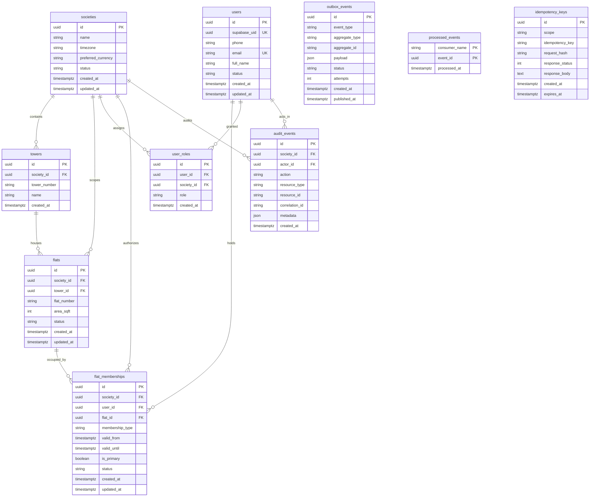

# Database Architecture & Schema Specification

## 1. System of Record Overview

The multi-tenant Society Operations Platform uses **Supabase PostgreSQL** (Mumbai `ap-south-1`) as its authoritative system of record.
- **Engine**: PostgreSQL 16 (hosted on Supabase)
- **Connection Endpoint**: Supabase Shared Transaction Pooler (PgBouncer port `6543`)
- **Driver**: Psycopg 3 (`psycopg[binary]>=3.1.18`)
- **ORM**: SQLAlchemy 2.0 with strict typing (`Mapped[...]`, `mapped_column`)
- **Schema Management**: Version-controlled Alembic migrations only (zero `create_all()` in production code)
- **Security & RLS**: PostgreSQL Row-Level Security (RLS) enabled on all core tables for defense-in-depth
- **Monetary Precision**: All monetary values are strictly represented in integer paise (e.g. ₹1,000.00 is stored as `100000`). Storing money in floating-point columns is strictly prohibited to eliminate IEEE 754 rounding errors.

---

## 2. Supabase Shared Transaction Pooler & Lambda Configuration

AWS Lambda instances connect to Supabase PostgreSQL using its shared transaction pooler:
```python
engine = create_engine(
    settings.DATABASE_URL,
    pool_size=1,
    max_overflow=0,
    pool_pre_ping=True,
    connect_args={
        "sslmode": "require",
        "prepare_threshold": None,  # Disables prepared statements for PgBouncer transaction mode
    },
)
```

### Critical Invariants:
1. **Disable Prepared Statements (`prepare_threshold: None`)**: PgBouncer in transaction pooling mode routes individual transactions across heterogeneous backend connections. Prepared statements must be disabled in Psycopg 3 to prevent "prepared statement does not exist" errors.
2. **Small Per-Lambda Pool (`pool_size=1, max_overflow=0`)**: Prevents connection exhaustion when multiple Lambda concurrent workers scale.
3. **Module-Scoped Engine**: Retained in global memory across warm Lambda invocations to eliminate connection handshake latency.
4. **Secrets Manager Storage**: The exact transaction pooler connection URI is stored securely in AWS Secrets Manager and encrypted with AWS KMS.

---

## 3. Entity Relationship Diagram (ERD)



---

## 4. Table Specifications & Constraints

### 4.1 Identity Domain

#### `societies`
- Root tenant anchor. All residential assets, billing ledgers, and access boundaries scope directly to a society.
- Columns: `id` (UUID PK), `name` (VARCHAR 255), `timezone` (VARCHAR 64, default 'Asia/Kolkata'), `preferred_currency` (VARCHAR 8, default 'INR'), `status` (ACTIVE, ONBOARDING, SUSPENDED), `created_at`, `updated_at`.

#### `towers`
- Tower buildings within a society (e.g. Tower 7, Tower 12, Tower 21).
- Composite Unique Constraint: `(society_id, tower_number)` prevents duplicate tower numbering within the same township.

#### `flats`
- Physical apartment units.
- Composite Unique Constraint: `(tower_id, flat_number)` guarantees unit number uniqueness per tower.
- Foreign Key with `ON DELETE CASCADE` to both `societies` and `towers`.

#### `users` (Application Profile Table)
- Application user profile table linked to `auth.users` via `supabase_uid`.
- Constraints: `supabase_uid` (UUID, UNIQUE, INDEXED), `phone` (VARCHAR 32, INDEXED), `email` (VARCHAR 255, NULLABLE, UNIQUE).
- Never modified directly by Supabase Auth; synced via application domain logic.

#### `flat_memberships`
- Links a user to a specific flat as an `OWNER`, `TENANT`, or `FAMILY_MEMBER`.
- Check Constraint: `valid_until IS NULL OR valid_until >= valid_from` ensures lease integrity.
- Compound Index: `(user_id, status)` for fast authorization lookup.

#### `user_roles`
- Granular RBAC assignments.
- Valid Roles: `RESIDENT` and `HELPDESK`.
- Unique Constraint: `(user_id, society_id, role)` prevents duplicate role assignments.

---

### 4.3 Billing Domain (Phase 2)

#### `billing_configurations`
- Society-level billing configuration parameters.
- Fields: `id` (UUID PK), `society_id` (UUID FK, UNIQUE), `rate_paise_per_sqft` (BIGINT, positive), `currency` (VARCHAR 8, default 'INR'), `due_day` (INTEGER, 1-28), `effective_from` (TIMESTAMPTZ), `created_at`, `updated_at`.

#### `invoices`
- Monthly apartment maintenance invoices.
- Fields: `id` (UUID PK), `society_id` (UUID FK), `flat_id` (UUID FK), `billing_period` (VARCHAR 7, 'YYYY-MM'), `invoice_number` (VARCHAR 64), `area_sqft_snapshot` (INTEGER), `rate_paise_per_sqft_snapshot` (BIGINT), `subtotal_paise` (BIGINT), `total_paise` (BIGINT), `due_date` (TIMESTAMPTZ), `status` (UNPAID, PARTIALLY_PAID, PAID, OVERDUE, VOID), `created_at`, `updated_at`.
- Unique Constraints:
  - `(society_id, flat_id, billing_period)` enforces at most 1 invoice per apartment per period.
  - `(society_id, invoice_number)` guarantees unique invoice numbers within the society.
- Check Constraints: `total_paise >= 0`, `subtotal_paise >= 0`, `area_sqft_snapshot > 0`, `rate_paise_per_sqft_snapshot > 0`.

#### `invoice_line_items`
- Itemized charges composing an invoice.
- Fields: `id` (UUID PK), `invoice_id` (UUID FK), `description` (VARCHAR 255), `quantity` (INTEGER, > 0), `unit_rate_paise` (BIGINT), `amount_paise` (BIGINT, >= 0), `created_at`.

#### `payments`
- Financial receipts and simulated payment transactions.
- Fields: `id` (UUID PK), `society_id` (UUID FK), `flat_id` (UUID FK), `amount_paise` (BIGINT, > 0), `currency` (VARCHAR 8), `provider` (VARCHAR 32, default 'SIMULATED'), `provider_reference` (VARCHAR 128), `status` (PENDING, SUCCESS, FAILED, REFUNDED), `initiated_by` (UUID FK), `created_at`, `updated_at`.
- Unique Constraint: `(provider, provider_reference)` guarantees duplicate payment reference prevention.

#### `payment_allocations`
- Explicit mapping of payment funds to invoices.
- Fields: `id` (UUID PK), `payment_id` (UUID FK), `invoice_id` (UUID FK), `allocated_paise` (BIGINT, > 0), `created_at`.
- Unique Constraint: `(payment_id, invoice_id)` prevents duplicate allocation of the same payment to an invoice.

#### `financial_ledger_entries`
- **Append-Only Journal**: Immutable financial ledger tracking all debits, credits, and balance changes.
- Invariant: Never edit or delete rows. Corrections use explicit compensating reversal or adjustment entries referencing `reference_id`.
- Fields: `id` (UUID PK), `society_id` (UUID FK), `flat_id` (UUID FK), `invoice_id` (UUID FK, nullable), `payment_id` (UUID FK, nullable), `entry_type` (CHARGE, PAYMENT_RECEIVED, PAYMENT_ALLOCATED, REVERSAL, ADJUSTMENT), `amount_paise` (BIGINT, > 0), `reference_id` (VARCHAR 128, nullable), `description` (VARCHAR 255), `created_at`.

#### `billing_runs`
- Execution logs and metadata for society monthly billing generation.
- Fields: `id` (UUID PK), `society_id` (UUID FK), `billing_period` (VARCHAR 7), `total_eligible_flats` (INTEGER), `total_invoiced_flats` (INTEGER), `total_skipped_flats` (INTEGER), `total_charges_paise` (BIGINT), `status` (VARCHAR 32), `initiated_by` (UUID FK), `metadata` (JSON), `created_at`.

---

## 5. Row-Level Security (RLS)

All application and billing tables enable PostgreSQL Row-Level Security with `FORCE ROW LEVEL SECURITY`:
```sql
ALTER TABLE invoices ENABLE ROW LEVEL SECURITY;
ALTER TABLE invoices FORCE ROW LEVEL SECURITY;
ALTER TABLE payments ENABLE ROW LEVEL SECURITY;
ALTER TABLE payments FORCE ROW LEVEL SECURITY;
ALTER TABLE payment_allocations ENABLE ROW LEVEL SECURITY;
ALTER TABLE payment_allocations FORCE ROW LEVEL SECURITY;
ALTER TABLE financial_ledger_entries ENABLE ROW LEVEL SECURITY;
ALTER TABLE financial_ledger_entries FORCE ROW LEVEL SECURITY;
```

### RLS Policies
- **Resident Read Isolation**:
  - `invoices_authenticated_select`: A resident can only view invoices if their `auth.uid()` maps to an active, approved `flat_membership` where `flat_id = invoices.flat_id` and `current_timestamp BETWEEN valid_from AND COALESCE(valid_until, 'infinity')`. Expired tenants immediately lose access.
  - `payments_authenticated_select`: A resident can only query payments for their authorized active flat.
  - `ledger_authenticated_select`: A resident can only view ledger records associated with their authorized flat.
- **Service Role & Helpdesk Authority**:
  - Direct modifications (`INSERT`, `UPDATE`, `DELETE`) by untrusted `authenticated` roles are forbidden. All financial mutations must be mediated by FastAPI domain service transactions via the backend database role.

