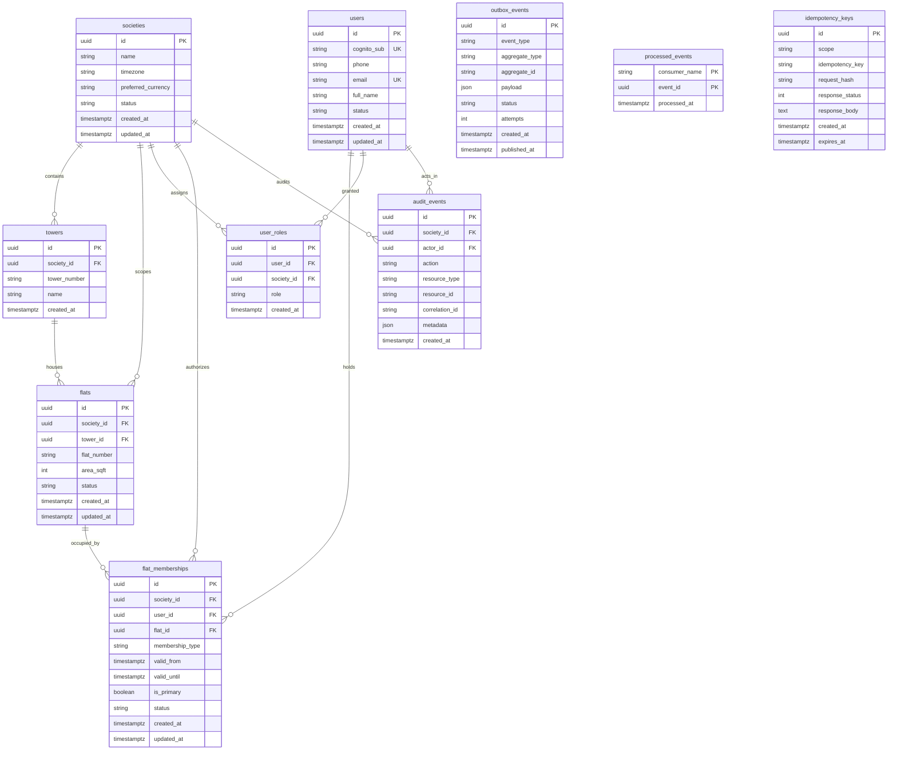

# Database Architecture & Schema Specification

## 1. System of Record Overview

The multi-tenant Society Operations Platform uses **PostgreSQL 16** as its authoritative system of record.
- **Engine**: PostgreSQL 16
- **Driver**: Psycopg 3 (`psycopg[binary]>=3.1.18`)
- **ORM**: SQLAlchemy 2.0 with strict typing (`Mapped[...]`, `mapped_column`)
- **Schema Management**: Alembic migrations only (zero `create_all()` in production code)
- **Monetary Precision**: All monetary values are strictly represented in integer paise (e.g. ₹1,000.00 is stored as `100000`). Storing money in floating-point columns is strictly prohibited to eliminate IEEE 754 rounding errors.

---

## 2. Entity Relationship Diagram (ERD)

---

## 3. Table Specifications & Constraints

### 3.1 Identity Domain

#### `societies`
- Root tenant anchor. All residential assets, billing ledgers, and access boundaries scope directly to a society.
- Columns: `id` (UUID PK), `name` (VARCHAR 255), `timezone` (VARCHAR 64, default 'Asia/Kolkata'), `preferred_currency` (VARCHAR 8, default 'INR'), `status` (ACTIVE, ONBOARDING, SUSPENDED), `created_at`, `updated_at`.

#### `towers`
- Tower buildings within a society (e.g. Tower 7, Tower 12, Tower 21).
- Composite Unique Constraint: `(society_id, tower_number)` prevents duplicate tower numbering within the same township.

#### `flats`
- Physical apartment units.
- Composite Unique Constraint: `(tower_id, flat_number)` guarantees unit number uniqueness per tower.
- Foreign Key with `ON DELETE CASCADE` to both `societies` and `towers`.

#### `users`
- Platform accounts mapped to Cognito subjects.
- Constraints: `cognito_sub` (UNIQUE, INDEXED), `email` (UNIQUE, INDEXED).
- Status: `ACTIVE`, `INACTIVE`, `SUSPENDED`.

#### `flat_memberships`
- Relationship binding an individual user to a specific apartment.
- Supports residents belonging to multiple flats.
- Check Constraint: `ck_membership_valid_dates` enforces `valid_until IS NULL OR valid_until >= valid_from`.
- Tenant Leases: `valid_until` is enforced on all resident requests. If current timestamp exceeds `valid_until`, access is denied automatically by the security layer.

#### `user_roles`
- Role-based authorization per society.
- Roles: `RESIDENT`, `HELPDESK`. Committee reporting is a read-only helpdesk capability, not a separate role.
- Composite Unique Constraint: `(user_id, society_id, role)`.

---

### 3.2 Platform Reliability & Messaging Domain

#### `audit_events`
- Append-only compliance log.
- Indexed by `correlation_id`, `resource_id`, `actor_id`, and `society_id` for distributed transaction tracing.

#### `outbox_events`
- Implements the Transactional Outbox pattern.
- Columns: `event_type`, `aggregate_type`, `aggregate_id`, `payload` (JSONB), `status` (PENDING, PUBLISHED, FAILED), `attempts`, `published_at`.
- Index: `(status, attempts, created_at)` allows high-throughput polling workers using `SELECT ... FOR UPDATE SKIP LOCKED` without locking table scans.

#### `processed_events`
- Prevents duplicate message execution across SQS consumers.
- Primary Key: `(consumer_name, event_id)` guarantees consumer idempotency within the business transaction.

#### `idempotency_keys`
- API-level idempotency store for payment operations, bill generation, and state-mutating requests.
- Unique Constraint: `(scope, idempotency_key)` with automatic expiry TTL.

---

## 4. Migration Strategy

Schema changes follow zero-downtime expand/contract rules:
1. **Never edit existing migration scripts**: Always generate forward migrations using `alembic revision -m "..."`.
2. **Backward-compatible changes first**: Add new columns as nullable or with defaults before updating code.
3. **Automated CI Validation**: CI executes migrations against an empty PostgreSQL database instance on every pull request.
