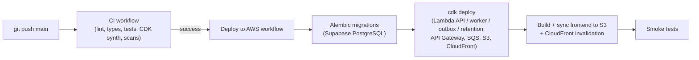

# Continuous Deployment to AWS

Pushing to `main` deploys automatically **after CI passes**:



If CI fails, nothing is deployed. Deploys are serialized (never two at once).

Workflow: [`.github/workflows/deploy-aws.yml`](../.github/workflows/deploy-aws.yml)

| Trigger | Target environment |
| :--- | :--- |
| Push to `main` (after CI succeeds) | Repo variable `AWS_DEPLOY_ENV` (default `staging`) |
| Manual: Actions → *Deploy to AWS* → *Run workflow* | `dev`, `staging` or `prod` (your choice) |

> [!IMPORTANT]
> The workflow stays **dormant** until you set the repo variable `AWS_DEPLOY_ENABLED=true`
> (step 5 below). Nothing here touches AWS until you complete the one-time setup.

## One-time setup (per environment)

You need an AWS account with permission to create IAM roles, plus the AWS CLI configured locally.

### 1. Bootstrap CDK (once per account/region)

```bash
cd infra/cdk
pip install -r requirements.txt
cdk bootstrap aws://<ACCOUNT_ID>/ap-south-1
```

### 2. Create the GitHub → AWS trust role (OIDC, no access keys)

```bash
aws cloudformation deploy \
  --stack-name township-github-oidc-staging \
  --template-file infra/bootstrap/github-oidc-role.yaml \
  --capabilities CAPABILITY_NAMED_IAM \
  --parameter-overrides EnvironmentName=staging
```

For a second environment in the same account, pass `CreateOidcProvider=false` and
`ExistingOidcProviderArn=arn:aws:iam::<ACCOUNT_ID>:oidc-provider/token.actions.githubusercontent.com`.

Copy the `DeployRoleArn` output. The role can only be assumed by this repository's jobs that run in the
matching GitHub Environment, and can only: assume the CDK bootstrap roles, sync the web bucket, invalidate
CloudFront, and read the database secret.

### 3. First infrastructure deploy and database secret

The very first deploy creates the Secrets Manager secret, which starts **empty**. Deploy once by hand, then
fill it in (the API Lambdas and the migration step both read it):

```bash
cd infra/cdk
REQUIRE_DOCKER=true CDK_SKIP_DOCKER_BUNDLING=false cdk deploy TownshipOps-Staging -c env=staging

aws secretsmanager put-secret-value \
  --secret-id township-supabase-credentials-staging \
  --secret-string '{"DATABASE_URL":"postgresql+psycopg://...","SUPABASE_URL":"https://<project>.supabase.co"}'
```

Use the Supabase **transaction pooler** (port 6543) URL here; that is what the Lambdas need.

### 4. Configure GitHub

In the repository: **Settings → Environments → New environment** named exactly `staging` (and `prod`/`dev`
as needed). In each environment add:

| Type | Name | Value |
| :--- | :--- | :--- |
| Secret | `AWS_DEPLOY_ROLE_ARN` | `DeployRoleArn` from step 2 |
| Secret *(optional, recommended)* | `MIGRATION_DATABASE_URL` | Supabase **direct / session** URL (port 5432). Migrations (DDL) can fail through the transaction pooler. If unset, the URL from the secret is used. |
| Variable | `VITE_SUPABASE_URL` | `https://<project>.supabase.co` |
| Variable | `VITE_SUPABASE_PUBLISHABLE_KEY` | Supabase publishable (anon) key |

Optional repository-level variable: `AWS_REGION` (default `ap-south-1`).

> [!TIP]
> On the `prod` environment enable **Required reviewers**. Production deploys then pause for a manual approval.

### 5. Switch it on

**Settings → Secrets and variables → Actions → Variables** (repository level):

| Variable | Value |
| :--- | :--- |
| `AWS_DEPLOY_ENABLED` | `true` |
| `AWS_DEPLOY_ENV` | `staging` (or `dev`; whichever environment `main` should auto-deploy to) |

From now on, every push to `main` that passes CI is deployed.

## What a deploy does

1. **Migrates the database** with `alembic upgrade head`, resolving the connection from Secrets Manager
   (or `MIGRATION_DATABASE_URL`). It aborts if the URL would point to localhost.
2. **`cdk deploy`** builds the Lambda bundle in the Amazon Linux image (`REQUIRE_DOCKER=true`, so Python
   dependencies are packaged) and updates the API, worker, outbox and retention functions and any infra changes.
3. **Builds the frontend** with `VITE_API_URL` taken from the stack's `ApiUrl` output, uploads it to the web
   bucket (hashed assets cached for a year, `index.html`/service worker always revalidated) and invalidates CloudFront.
4. **Smoke tests** `GET <api>/health/live` and the CloudFront URL.

> [!WARNING]
> Migrations run **before** the new code goes live, so keep migrations backward compatible (additive:
> add columns/tables, don't drop or rename in the same release). Migrations are not rolled back automatically.

## Rolling back

Re-run the workflow manually from a known-good commit (**Run workflow** → choose the branch/tag), or revert
the commit on `main`. Revert any destructive migration by hand with `alembic downgrade`.

## Troubleshooting

| Symptom | Cause |
| :--- | :--- |
| Workflow shows *skipped* | `AWS_DEPLOY_ENABLED` is not `true`, or CI did not succeed on a push to `main`. |
| `Could not assume role` | `AWS_DEPLOY_ROLE_ARN` wrong, or the GitHub Environment name differs from `EnvironmentName` in the trust stack. |
| `cdk deploy` fails on bootstrap | Run `cdk bootstrap` (step 1) for that account/region. |
| Migration step: `Failed to retrieve required secret` | Secret not created/filled yet (step 3), or wrong environment. |
| Smoke test fails with 5xx | `DATABASE_URL`/`SUPABASE_URL` missing in the Secrets Manager secret; check the API Lambda CloudWatch logs. |
