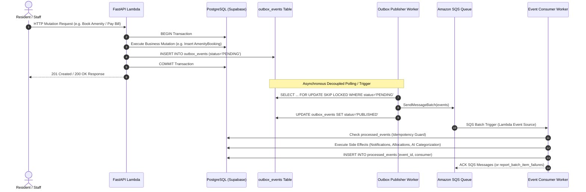
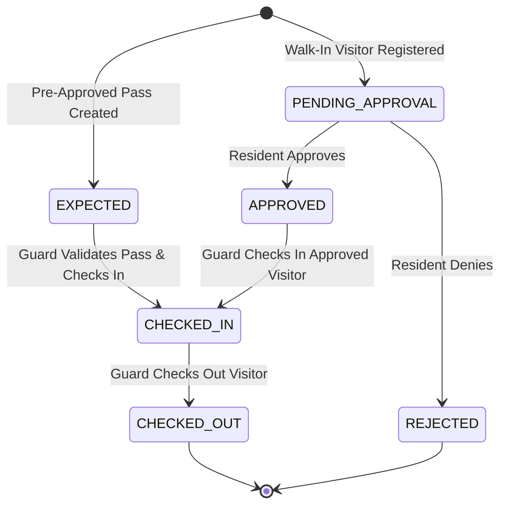
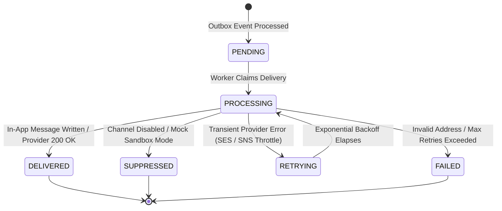
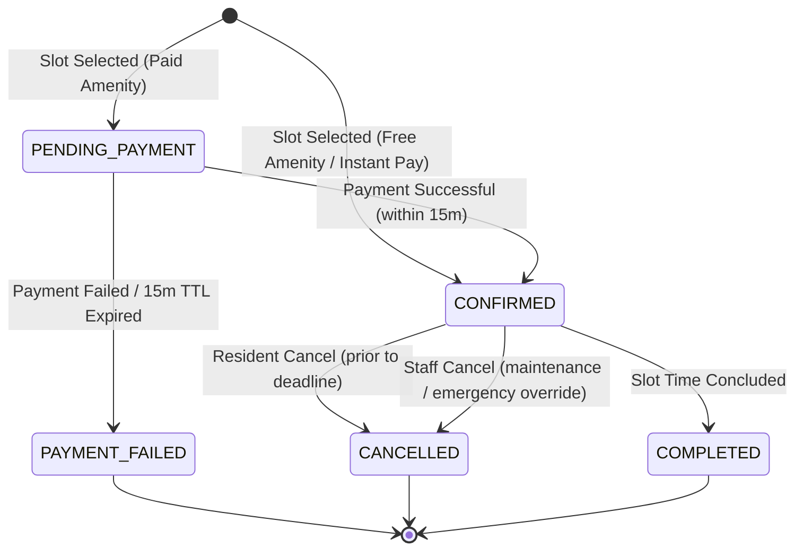

# Technical Design Document (TDD)
# Township Operations Platform
**Target Scope**: 2,400 Apartments | 28 Towers | 180 Facility Staff | Pune, Maharashtra  
**Document Revision**: Phase 9 Complete (Official Township Notices & Resident Communications)  
**Date**: November 2026  
**Status**: APPROVED & IMPLEMENTED  

---

## 1. Executive Summary & Problem Context

The **Township Operations Platform** (`township-ops`) is an enterprise-grade, multi-tenant property governance and facility automation system engineered for large-scale residential communities in India. The reference installation models **Marvel Greenfield Residences** in Pune, Maharashtra:

- **Physical Scale**: 2,400 residential flats distributed across 28 residential towers (Towers A through AB), with communal amenities, internal roads, and multiple security entry gates.
- **Human Scale**: Approximately 9,000 residents and 180 on-site facility management staff spanning helpdesk supervisors, electrical, plumbing, civil maintenance technicians, security guards, and estate managers.
- **Financial Scale**: Standard maintenance billing at ₹6.50 per sq. ft. per month (e.g., ₹7,475/month for a standard 1,150 sq. ft. 2BHK flat), generating over ₹1.79 Crore in monthly collections. Payment channels encompass UPI, NEFT/RTGS bank transfers, and physical cheques.
- **Operational Challenges Solved**:
  - Eliminating error-prone manual bank reconciliation against unformatted banker narrations.
  - Automating invoice generation with strict integer-paise double-entry accounting.
  - Enforcing service level agreements (SLAs) on resident maintenance and emergency tickets.
  - Ensuring physical security through gated visitor tracking with offline tablet sync and 90-day privacy retention.
  - Coordinating fair, race-condition-free reservations for scarce township amenities (clubhouse, tennis courts, badminton courts, community halls).
  - Broadcasting official federation notices and emergency circulars with tower and flat-level targeting.

---

## 2. Architectural Foundation & Core Principles

### 2.1 The Two-Role Strict RBAC Model with Granular Permissions
The application rejects role explosion, adhering to strictly **two core application roles** at the identity and routing layer:
1. `RESIDENT`: Scoped strictly to flats where the user holds an active, approved, and non-expired tenancy or ownership record.
2. `HELPDESK`: Authorized facility management staff, estate managers, technicians, and committee auditors.

Operational capabilities are granted to `HELPDESK` users via explicit, granular permissions stored in the `user_permissions` table:
- `COMPLAINT_MANAGE`: Triage, update, assign, and resolve complaint tickets.
- `BANK_IMPORT`: Upload and parse bank statement CSV/CAMT/MT files.
- `RECONCILIATION_REVIEW`: Propose and approve financial matching allocations (with strict maker-checker enforcement).
- `BILLING_MANAGE`: Configure billing cycles, generate monthly invoice runs, and apply late fees.
- `COMMITTEE_REPORT_READ`: Read-only governance visibility into executive financial summaries, ageing arrears, and CSV export.
- `GATE_OPERATIONS`: Check in and check out visitors at society security gates (requires active temporal gate assignment).

### 2.2 PostgreSQL Row-Level Security (RLS) & Multi-Tenant Scoping
Every database table enforces `FORCE ROW LEVEL SECURITY`:
- **Tenant Scoping**: All operational tables (`flats`, `invoices`, `payments`, `complaints`, `amenities`, `amenity_bookings`, `notices`, `gate_entries`) carry a foreign key to `societies.id`.
- **Resident Isolation**: Residents can query and modify only records bound to flats for which they hold an active, non-expired `FlatMembership`.
- **Staff Society Scoping**: Staff queries are restricted to assigned societies via the security-definer helper `public.is_helpdesk_for_society(society_id)`.
- **Defense in Depth**: Even if an application-layer bug omits a `WHERE society_id = :society_id` clause, the database engine enforces tenant boundaries.

### 2.3 Strict Integer Paise Monetary Precision
Floating-point data types (`FLOAT`, `REAL`, `DOUBLE PRECISION`) are prohibited in financial columns. All monetary quantities across billing, ledger, bank reconciliation, and amenity fees are stored as **64-bit BigInt paise** (1 INR = 100 paise; e.g., ₹7,475.00 is stored as `747500`). This completely eliminates IEEE 754 precision drift and rounding anomalies.

### 2.4 Immutable Append-Only Double-Entry Financial Ledger
No financial obligation, payment, or allocation record is ever modified or deleted. Balances are calculated dynamically from immutable ledger entries (`INVOICE`, `PAYMENT`, `ADJUSTMENT`, `LATE_FEE`). Modifying or deleting ledger records is blocked at the database engine level by the `financial_ledger_immutable` trigger. Any reversal or adjustment requires an explicit compensating ledger entry referencing the original transaction.

### 2.5 Timezone Correctness (`Asia/Kolkata`)
The facility operates in Pune, India. All facility-local scheduling decisions—operating hours, discrete slot generation, advance booking windows, cancellation deadlines, and midnight date boundaries—are evaluated in the `Asia/Kolkata` timezone (`ZoneInfo("Asia/Kolkata")`). Local timestamps are converted to UTC for persistence and instant comparison, ensuring correctness across date transitions.

---

## 3. Cloud Infrastructure & Deployment Architecture

### 3.1 Architecture Overview (Option B: Supabase + AWS Serverless)
The platform utilizes a modern serverless architecture combining **Supabase Cloud** for managed data persistence and authentication with **AWS Serverless** for compute, event queuing, and secure asset storage:

- **Supabase Cloud (`ap-south-1` Mumbai)**:
  - **Supabase Auth**: Manages resident passwordless Phone OTP authentication and issues ES256/RS256 JWTs verified asymmetrically by FastAPI via the Supabase JWKS endpoint.
  - **Supabase PostgreSQL 16**: Primary relational database with Row-Level Security (RLS) enabled on all tables.
  - **Supabase Shared Transaction Pooler (PgBouncer, Port 6543)**: Enables AWS Lambda to scale hundreds of concurrent executions without exhausting database connections. SQLAlchemy is configured with Psycopg 3 (`sslmode=require`, `prepare_threshold=None`, `pool_size=1`, `max_overflow=0`).
- **AWS Serverless (`ap-south-1` Mumbai)**:
  - **AWS Lambda**: Runs FastAPI backend compute using the Mangum ASGI adapter, maintaining zero idle cost and instantaneous auto-scaling.
  - **Amazon API Gateway**: Regional REST API routing requests to Lambda with CORS and AWS WAF filtering.
  - **Amazon SQS & DLQs**: Five asynchronous domain queues (`billing-jobs`, `payment-events`, `reconciliation-jobs`, `complaint-ai-jobs`, `notification-jobs`) with KMS CMK encryption and dead-letter queues.
  - **Worker Lambda**: Asynchronously consumes SQS queues using `report_batch_item_failures` and idempotent deduplication.
  - **Amazon S3**: Private KMS-encrypted buckets for complaint attachments, bank statements, and visitor photographs with 90-day lifecycle expiration.
  - **Amazon CloudFront**: Global CDN terminating TLS 1.3 and distributing the React TypeScript SPA.
  - **AWS Secrets Manager & KMS**: Stores database credentials, symmetric encryption keys, and environment configuration.
  - **Amazon CloudWatch & CloudTrail**: Centralized structured JSON logging, alarm metrics, and security audit trails.

### 3.2 Cloud Infrastructure Architecture Diagram

```mermaid
flowchart TB
    subgraph Clients ["Client Tier"]
        Browser["Resident & Staff Web App<br/>(React / Vite / TypeScript SPA)"]
        Tablet["Gate Security Tablet<br/>(Offline IndexedDB PWA)"]
    end

    subgraph Supabase ["Supabase Cloud (ap-south-1 Mumbai)"]
        SupabaseAuth["Supabase Auth<br/>(Phone OTP & JWKS Endpoint)"]
        TxPooler["Supabase Transaction Pooler<br/>(PgBouncer Port 6543)"]
        PostgreSQL[("Supabase PostgreSQL 16<br/>(Application Schema + RLS)")]
        TxPooler --> PostgreSQL
    end

    subgraph AWS ["Amazon Web Services (ap-south-1 Mumbai)"]
        subgraph Edge ["Edge & Perimeter Security"]
            CF["Amazon CloudFront CDN (TLS 1.3)"]
            WAF["AWS WAF (Rate Limiting, OWASP Top 10)"]
            S3Web["Private S3 Bucket (Static Web Assets)"]
            CF --> S3Web
        end

        subgraph Ingress ["API Gateway Tier"]
            APIGW["Amazon API Gateway (REST API)"]
            WAF -.->|Inspects & Filters| APIGW
        end

        subgraph ServerlessCompute ["Serverless Compute Tier (AWS Lambda)"]
            ApiLambda["FastAPI Lambda (Mangum)<br/>pool_size=1, prepare_threshold=None"]
            WorkerLambda["SQS Worker Lambda<br/>Idempotent Batch Consumer"]
            APIGW -->|Proxies Requests| ApiLambda
        end

        subgraph SQS ["Asynchronous Messaging Tier"]
            Q1["township-billing-jobs + DLQ"]
            Q2["township-payment-events + DLQ"]
            Q3["township-reconciliation-jobs + DLQ"]
            Q4["township-complaint-ai-jobs + DLQ"]
            Q5["township-notification-jobs + DLQ"]
        end

        subgraph SecurityTier ["Security & Secrets"]
            KMS["AWS KMS Master Key (CMK)"]
            Secrets["AWS Secrets Manager<br/>(DATABASE_URL & Signing Keys)"]
            CloudWatch["Amazon CloudWatch Logs & Metrics"]
            CloudTrail["AWS CloudTrail Audit Trail"]
        end

        subgraph Storage ["Document & Photo Storage"]
            S3Docs["Private S3 Bucket<br/>(Attachments, Statements, Visitor Photos)<br/>90-Day Retention Lifecycle"]
        end
    end

    Browser -->|HTTPS / Assets| CF
    Browser -->|Phone OTP Verification| SupabaseAuth
    Browser -->|REST API with Bearer JWT| APIGW
    Tablet -->|Batch Sync POST /gate/sync| APIGW

    ApiLambda -->|Asymmetric JWT Validation| SupabaseAuth
    ApiLambda -->|TLS Connection (PgBouncer)| TxPooler
    WorkerLambda -->|TLS Connection (PgBouncer)| TxPooler

    ApiLambda -->|Fetch Credentials| Secrets
    ApiLambda -->|Enqueues Outbox Events| Q1 & Q2 & Q3 & Q4 & Q5
    Q1 & Q2 & Q3 & Q4 & Q5 -->|Batch SQS Trigger| WorkerLambda

    ApiLambda -->|Presigned Upload / Download URLs| S3Docs
    KMS -.->|Encrypts at Rest| S3Docs
    KMS -.->|Encrypts at Rest| Q1 & Q2 & Q3 & Q4 & Q5
    KMS -.->|Encrypts Secrets| Secrets
    ApiLambda -.->|Structured JSON Logs| CloudWatch
```

---

## 4. Asynchronous Event Architecture & Outbox Pattern

### 4.1 Transactional Outbox Pattern
To prevent dual-write vulnerabilities between the database and message broker, all domain mutations commit outbox events to the `outbox_events` table inside the **exact same PostgreSQL database transaction** as the business entity changes.



### 4.2 SQS Queue Inventory & Specifications

| Queue Name | Purpose | DLQ Name | Max Receive Count | Visibility Timeout |
| :--- | :--- | :--- | :--- | :--- |
| `township-billing-jobs-{env}` | Monthly maintenance batch bill generation | `township-billing-jobs-dlq-{env}` | 3 (dev) / 5 (prod) | 300 seconds |
| `township-payment-events-{env}` | Payment webhook processing & ledger credit | `township-payment-events-dlq-{env}` | 3 (dev) / 5 (prod) | 120 seconds |
| `township-reconciliation-jobs-{env}` | Bank statement parser & auto-reconciliation | `township-reconciliation-jobs-dlq-{env}` | 3 (dev) / 5 (prod) | 300 seconds |
| `township-complaint-ai-jobs-{env}` | Complaint categorization & auto-routing | `township-complaint-ai-jobs-dlq-{env}` | 3 (dev) / 5 (prod) | 120 seconds |
| `township-notification-jobs-{env}` | Multi-channel resident alerts & emergency push | `township-notification-jobs-dlq-{env}` | 3 (dev) / 5 (prod) | 120 seconds |

---

## 5. Domain Subsystems Specification (Phases 1 through 8)

### 5.1 Identity & Resident Registry (Phase 1)
- **Membership Types**: `OWNER`, `TENANT`, `FAMILY_MEMBER`.
- **Tenancy Lease Boundary Enforcement**: `flat_memberships` records enforce `valid_from` and `valid_until`. If a lease expires, resident access to flat data terminates immediately.
- **E.164 Phone Normalization**: Phone numbers are sanitized to international E.164 format (`+91XXXXXXXXXX`). Self-registration requests enter `PENDING` state until staff verification.
- **Audit Trails**: All membership state transitions record structured audit events (`identity.membership.created`, `identity.membership.approved`, `identity.membership.terminated`).

### 5.2 Maintenance Billing & Double-Entry Ledger (Phase 2)
- **Rate Calculation**: `maintenance_paise = area_sqft * rate_paise_per_sqft` (e.g. 1,150 sq. ft. * 650 paise = 747,500 paise = ₹7,475.00).
- **Snapshot Pricing**: Generated invoices snapshot tariff rates, shielding historical bills from tariff changes.
- **Invoice Lifecycle**: Dynamic evaluation (`UNPAID` -> `PARTIALLY_PAID` -> `PAID` -> `OVERDUE` -> `VOID`) based on due dates and allocated ledger credits.
- **Late-Fee Engine**: Society bye-law policy evaluation supporting:
  - Flat Fee (paise)
  - Monthly Percentage (basis points)
  - Daily Simple Interest: `(unpaid * amount_or_rate_bps * days + 1825000) // 3650000`
- **Payment Allocation Concurrency Safety**: Acquires PostgreSQL row lock on invoices (`SELECT ... FOR UPDATE`) inside the payment transaction, recalculates balances, and enforces the `Idempotency-Key` header.

### 5.3 Complaints & Helpdesk Service Desk (Phase 3)
- **Auto-Assignment Engine**: Round-robin assignment to active staff in the society with the fewest open tickets.
- **SLA Tracking**:
  - First Response SLA (e.g., 15 minutes for EMERGENCY, 2 hours for HIGH).
  - Resolution SLA (e.g., 4 hours for EMERGENCY, 24 hours for HIGH).
- **Category Correction & Deduplication**: Staff can reclassify misrouted categories while preserving `original_category`, and link duplicate complaints to a primary parent ticket.
- **Presigned Uploads**: Attachments are stored in private S3 with size validation and malware scanning hooks.

### 5.4 Automated Bank Statement Reconciliation (Phase 4)
- **Deduplication Engine**: Concurrency-safe SHA-256 fingerprinting on `(society_id, transaction_date, amount_paise, narration)` enforced by a unique database constraint.
- **UPI VPA Normalization**: Regex extraction of UPI VPAs from banker narrations (`UPI/123456789012/PAYMENT/resident@okhdfcbank/...`).
- **Confidence Scoring & Promotion**:
  - Exact UPI VPA match: `confidence = 0.98` -> Auto-promoted to match.
  - Narration containing exact Tower + Flat + Amount: `confidence = 0.95` -> Promoted to match.
  - Partial match: Suggestion created for manual review.
- **Maker-Checker Segregation of Duties**: Users cannot approve proposals they submitted; requires `PENDING_APPROVAL` status before financial settlement.

### 5.5 Committee Financial Governance & Reporting (Phase 5)
- **Zero-Memory SQL Aggregates**: Executive financial summaries calculated directly via database aggregation over all 2,400 flats.
- **Ageing Arrears Buckets**: Live segregation of outstanding receivables:
  - 0–30 Days (Current)
  - 31–60 Days (Overdue)
  - 61–90 Days (Delinquent)
  - 90+ Days (Critical Recovery)
- **Tower Breakdown**: Tower-by-tower collection percentages and complaint volume.
- **CSV Formula Injection Mitigation (CWE-1236)**: Prepending single-quote `'` to cells starting with `=`, `+`, `-`, `@`, `\t`, or `\r`.

### 5.6 Gate & Visitor Management with Offline Sync (Phase 6)
- **Decoupled Approval & Entry State Machines**:
  - Approval: `PENDING` -> `APPROVED` | `REJECTED`, or `AUTO_APPROVED` via Guest Pass.
  - Entry: `EXPECTED` -> `CHECKED_IN` -> `CHECKED_OUT`.
  - Invariant: Guards cannot check in a visitor unless approval is `APPROVED` or `AUTO_APPROVED`.
- **Pre-Approved Guest Passes (`GP-XXXX`)**: Generated with CSPRNG salt/hash storage (`secrets.token_hex(16)` salt + SHA-256). Row locks (`SELECT ... FOR UPDATE`) prevent concurrent reuse.
- **Offline Gate Tablet Sync**: Walk-in visitor entries and captured JPEG photos are buffered in IndexedDB (`TownshipGateDB`) with client UUIDv4 event IDs and SHA-256 payload hashes. Reconnection sync (`POST /api/v1/gate/sync`) uses nested savepoints to prevent single-event failures from aborting batches.
- **Visitor Photo Privacy & 90-Day Retention**:
  - Photos stored under `visitor-photos/{society_id}/{year}/{month}/{visitor_id}.jpg` in KMS-encrypted S3.
  - Served via 15-minute presigned URLs only to authorized residents or on-duty gate staff.
  - Hard 90-day logical cutoff (`410 PHOTO_EXPIRED`), automated purge worker, and S3 lifecycle rule (`VisitorPhotos90DayRetention`).



### 5.7 Multi-Channel Communications & Resident Notifications (Phase 7)
- **Outbox Fan-Out**: Domain mutations emit outbox events that fan out to the SQS `notification-jobs` queue.
- **Multi-Channel Delivery State Machine**: Evaluates user preferences across In-App, Email, and SMS:
  - `PENDING` -> `PROCESSING` -> `SENT` | `DELIVERED` | `RETRYING` | `FAILED` | `SUPPRESSED`
  - Transient failures trigger exponential backoff: `backoff_seconds = (2 ^ attempt_count) * 10 + jitter(1..5)`.
- **PII Masking**: Log output masks emails (`n***i@example.com`) and phone numbers (`+91-XXXXX-XX210`).
- **Emergency Safety Override**: Critical safety alerts (`complaint.safety_escalated`, `URGENT` priority) bypass opt-out preferences and dispatch immediately across all channels.
- **Internal Note Isolation**: Helpdesk technician notes are strictly scrubbed from resident notification bodies.



### 5.8 Official Township Notices & Resident Communications (Phase 9 Complete)
- **Notice Categories**: 9 comprehensive categories tailored to 2,400-apartment township management:
  - `GENERAL`: Community updates and broad township notices.
  - `CIRCULAR`: Official administrative and legal circulars.
  - `MAINTENANCE`: Civil works, elevator maintenance, painting schedules.
  - `WATER`: Water tanker deliveries, borewell maintenance, supply cutoffs.
  - `ELECTRICITY`: Transformer overhauls, DG switchovers, grid power outages.
  - `SECURITY`: Gate protocols, surveillance maintenance, safety drills.
  - `EVENT`: Township celebrations, cultural festivities, AGM meetings.
  - `EMERGENCY`: Critical safety, fire drills, immediate evacuations.
- **Granular Multi-Targeting Across 28 Towers**:
  - `SOCIETY`: Entire township community broadcast across all 28 towers.
  - `TOWER`: Multi-tower targeting via `target_tower_ids` array, validated against the calling society.
  - `FLAT`: Multi-flat targeting via `target_flat_ids` array, validated against the calling society.
  - Dynamic loading of towers and flats via `/api/v1/notifications/staff/notices/targeting-options` (no hardcoding).
- **Publishing Lifecycle & Scheduling**:
  - State machine: `DRAFT` -> `SCHEDULED` -> `PUBLISHED` -> `ARCHIVED`.
  - Future scheduling: Setting `published_at` in the future with status `SCHEDULED`. Immediate delivery is withheld until effective time.
  - Background worker execution: Worker runs `publish_due_scheduled_notices` every 30 seconds using PostgreSQL row-level locking (`SELECT ... FOR UPDATE SKIP LOCKED`) to ensure distributed worker safety without duplicate publishing.
- **Publication Versioning & Audit Trail**:
  - Monotonically increasing revision counter (`Notice.version = 1, 2, ...`).
  - Version-scoped broadcast idempotency keys (`notice_publish:{id}:v{version}`, `notice_emergency:{id}:v{version}`).
  - Outbox deduplication checks both `aggregate_id` and payload `broadcast_key` / version, enabling notice edits to be republished with fresh outbox events while deduplicating exact replays.
  - Multi-channel delivery idempotency keys (`in_app:{id}:v{version}:{resident_id}`, `email:{id}:v{version}:{resident_id}`, `sms:{id}:v{version}:{resident_id}`) guarantee accurate delivery fan-out per version.
  - Emergency Broadcast Confirmation Gate: Dispatching emergency alerts (`deliver_emergency: true`) strictly requires affirmative confirmation (`confirm_emergency_broadcast: true`). Informational categorization as `EMERGENCY` or priority `URGENT` alone does not bypass user notification preferences.
  - Immutable audit logging on each state transition and edit (`NOTICE_CREATED`, `NOTICE_UPDATED`, `NOTICE_PUBLISHED`, `NOTICE_ARCHIVED`).
- **Resident Security & Access Control**:
  - IDOR protection: Detail (`GET /resident/notices/{id}`) and read tracking (`POST /resident/notices/{id}/read`) strictly enforce membership in the target society, flat/tower targeting predicates, active `PUBLISHED` status, and publication time (`published_at <= now` and `expires_at >= now`).
  - Read receipts: Per-resident read tracking with `POST /resident/notices/read-all` and unread badge count (`GET /resident/notices/unread-count`).
- **Staff Operations & Analytics**:
  - Protected by dedicated `COMMUNICATIONS_MANAGE` permission across all endpoints (notices list, detail, overview statistics, dynamic towers and flats targeting directories); gate-only operators holding only `GATE_OPERATIONS` receive HTTP 403 Forbidden.
  - KPI overview metrics (`GET /staff/notices/overview`): Total, Published, Scheduled, Drafts, Archived, and Emergency notices.
  - Manual processing endpoint (`POST /staff/notices/publish-scheduled`) for immediate administrator triggering.
- **Trilingual Internationalization**:
  - Full UI localization in English (`en`), Hindi (`hi`), and Marathi (`mr`) for resident notice feeds, category filters, emergency banners, and staff management dashboards.

### 5.9 Amenity & Facility Booking System (Phase 8)
- **Amenity Entity**: Supports single-unit facilities (tennis courts, badminton courts, clubhouse lounge) and multi-unit shared facilities (swimming pool, gym). Tracks operating hours, slot duration, hourly fee in paise, advance booking days, cancellation deadline hours, refund percentage, and permitted membership types.
- **Concurrency & Overbooking Prevention**: Booking transactions acquire a PostgreSQL row lock on the amenity row (`SELECT ... FOR UPDATE`), verify tenancy lease validity for the target booking date, and check that active bookings plus requested units do not exceed total capacity.
- **Timezone Correctness**: Slot times and date windows are computed in `Asia/Kolkata` local time and persisted in UTC.
- **Payment Lifecycle & 15-Minute Slot Lock**:
  - Paid amenity bookings enter `PENDING_PAYMENT` with a 15-minute expiration lock (`payment_expires_at`).
  - Payments are processed with idempotency keys via `PaymentProvider`.
  - Expired or failed payments transition bookings to `PAYMENT_FAILED`, releasing capacity immediately.
- **Historical Fee Immutability**: Staff fee updates only affect future bookings. Existing reservations retain their historical fee and payment records.
- **Cancellation & Refunds**:
  - Resident cancellation prior to `cancellation_deadline_hours` calculates configured `refund_percentage` in paise.
  - Staff operational cancellations (e.g., court flooding) issue 100% full refunds and log an audit reason.
- **Staff Maintenance Blocks**: Allows staff to block time windows for maintenance, automatically rejecting resident booking attempts with `409 SLOT_BLOCKED`.



---

## 6. Database Schema & Migration Inventory

All schema changes are version-controlled via Alembic migrations. Runtime `create_all()` is strictly forbidden in production.

| Revision | File Name | Domain / Purpose | Key Tables & Constraints |
| :--- | :--- | :--- | :--- |
| `001` | `001_initial_schema.py` | Core township foundation | `societies`, `towers`, `flats`, `users`, `user_roles`, `flat_memberships`, `audit_events`, `outbox_events`, `processed_events`, `idempotency_keys` |
| `002` | `002_supabase_auth_and_rls.py` | Auth & security policies | Adds `supabase_uid` to `users`, enables PostgreSQL RLS on all tables, installs `is_helpdesk_for_society` security-definer function |
| `003` | `003_maintenance_billing.py` | Maintenance billing schema | `billing_cycles`, `invoices`, `invoice_line_items`, `payments`, `payment_allocations`, `financial_ledger_entries`, `billing_runs` |
| `004` | `004_billing_integrity_remediation.py` | Ledger immutability & composite FKs | Composite unique `flats(society_id, id)`, composite FKs `(society_id, flat_id)` on `invoices` & `financial_ledger_entries`, trigger `financial_ledger_immutable` |
| `005` | `005_complaints_domain.py` | Complaints & service desk | `complaint_tickets`, `complaint_comments`, `complaint_attachments`, `complaint_activity_logs`, SLA tracking columns |
| `006` | `006_attachment_lifecycle_and_ai_metadata.py` | S3 attachment lifecycle & AI tags | S3 keys, virus-scan status, Bedrock AI classification tags on complaints |
| `007` | `007_worker_claim_token.py` | Distributed worker leasing | Adds `claim_token` and `claim_expires_at` to `outbox_events` for concurrency-safe polling |
| `008` | `008_bank_reconciliation.py` | Automated bank reconciliation | `bank_statements`, `bank_transactions`, `reconciliation_matches`, `reconciliation_suggestions` |
| `009` | `009_reconciliation_allocation_tenant_integrity.py` | Tenant integrity on allocations | Composite foreign keys and tenant isolation on reconciliation match allocations |
| `010` | `010_bank_transaction_fingerprint_unique.py` | Bank transaction deduplication | SHA-256 fingerprint uniqueness constraint on `(society_id, transaction_date, amount_paise, narration)` |
| `011` | `011_phase5_core_governance.py` | Committee governance & late fees | Committee aggregation views, late fee rules on `billing_cycles` |
| `012` | `012_user_permissions.py` | Granular user permissions | `user_permissions` table granting granular capabilities to `HELPDESK` role users |
| `013` | `013_gate_visitor_management.py` | Gate & visitor management | `gates`, `gate_assignments`, `visitor_passes`, `gate_entries`, `visitor_photos` |
| `014` | `014_reconcile_visitor_schema.py` | Visitor schema reconciliation | IndexedDB client sync columns, photo S3 retention timestamps |
| `015` | `015_notification_system.py` | Notification engine | `notifications`, `notification_deliveries`, `user_notification_preferences` |
| `016` | `016_amenities_foundation.py` | Amenity booking foundation | `amenities`, `amenity_bookings`, operating hours, integer paise fees |
| `017` | `017_amenity_blocks_and_payments.py` | Amenity maintenance & payments | `amenity_blocks`, 15-minute slot lock (`payment_expires_at`), cancellation policies |
| `018` | `018_official_township_notices.py` | Official township notices | `notices`, `notice_reads`, society/tower/flat targeting, pinning, scheduled publishing |
| `019` | `019_notice_multi_targeting.py` | Multi-tower and flat targeting | Dynamic array targeting: `target_tower_ids`, `target_flat_ids` across 28 towers |
| `020` | `020_notice_version_schedule.py` | Notice revision and scheduling | `notices.version` revision sequence, index `ix_notices_status_published_at` for scheduled worker |

---

## 7. REST API Endpoints Specification

All endpoints are versioned under the `/api/v1` prefix.

| Domain | Method | Endpoint | Authorization | Description |
| :--- | :--- | :--- | :--- | :--- |
| **Identity & Auth** | `GET` | `/api/v1/me` | Authenticated | Fetch current user profile, assigned roles, active flats, and permissions |
| | `GET` | `/api/v1/flats` | `RESIDENT` / `HELPDESK` | List accessible flats scoped to tenant |
| | `GET` | `/api/v1/registry/residents` | `HELPDESK` | List registered township residents with filter by tower/flat |
| **Billing & Finance** | `GET` | `/api/v1/billing/invoices` | Authenticated | List invoices (resident sees owned flats; staff sees society) |
| | `POST` | `/api/v1/billing/runs` | `BILLING_MANAGE` | Trigger monthly maintenance billing run for society |
| | `POST` | `/api/v1/billing/payments` | Authenticated (`RESIDENT`) | Submit invoice payment with `Idempotency-Key` header |
| | `POST` | `/api/v1/billing/late-fees` | `BILLING_MANAGE` | Execute late fee assessment batch run |
| **Bank Reconciliation**| `POST` | `/api/v1/reconciliation/statements` | `BANK_IMPORT` | Upload and parse bank statement CSV/CAMT/MT file |
| | `GET` | `/api/v1/reconciliation/matches` | `RECONCILIATION_REVIEW` | List automated reconciliation matches |
| | `POST` | `/api/v1/reconciliation/approve` | `RECONCILIATION_REVIEW` | Approve proposed reconciliation match (maker-checker enforced) |
| **Complaints Desk** | `GET` | `/api/v1/complaints` | Authenticated | List complaints with status, priority, and search filters |
| | `POST` | `/api/v1/complaints` | `RESIDENT` | Lodge maintenance ticket with attachments |
| | `PATCH` | `/api/v1/complaints/{id}` | `COMPLAINT_MANAGE` | Update complaint status, assign technician, or add internal note |
| **Committee Governance**| `GET` | `/api/v1/committee/summary` | `COMMITTEE_REPORT_READ`| Executive financial aggregate summary across all 2,400 flats |
| | `GET` | `/api/v1/committee/ageing` | `COMMITTEE_REPORT_READ`| Ageing arrears analysis (0-30, 31-60, 61-90, 90+ days) |
| | `GET` | `/api/v1/committee/export` | `COMMITTEE_REPORT_READ`| Formula-sanitized CSV export of society financials |
| **Gate Management** | `POST` | `/api/v1/resident/visitors/passes` | `RESIDENT` | Generate pre-approved guest pass (`GP-XXXX`) |
| | `POST` | `/api/v1/gate/entries` | `GATE_OPERATIONS` | Guard registers walk-in visitor or checks in guest pass |
| | `POST` | `/api/v1/gate/sync` | `GATE_OPERATIONS` | Offline tablet reconnect batch sync with replay protection |
| | `POST` | `/api/v1/resident/visitors/{id}/approve` | `RESIDENT` | Resident approves or rejects walk-in visitor entry request |
| **Notifications** | `GET` | `/api/v1/notifications` | Authenticated | Fetch resident in-app notifications inbox with pagination |
| | `PATCH` | `/api/v1/notifications/{id}/read` | Authenticated | Mark notification as read |
| | `GET` | `/api/v1/notifications/deliveries` | `HELPDESK` | Multi-channel delivery monitoring log |
| **Official Notices** | `GET` | `/api/v1/notifications/resident/notices` | Authenticated | Fetch targeted notices feed with search, priority, and category filters |
| | `GET` | `/api/v1/notifications/resident/notices/{id}` | Authenticated | Fetch single notice detail with targeting and temporal predicate checks |
| | `GET` | `/api/v1/notifications/resident/notices/unread-count` | Authenticated | Get unread notice badge count for calling resident |
| | `POST` | `/api/v1/notifications/resident/notices/{id}/read` | Authenticated | Mark notice as read for the calling resident |
| | `POST` | `/api/v1/notifications/resident/notices/read-all` | Authenticated | Mark all visible notices as read for calling resident |
| | `GET` | `/api/v1/notifications/staff/notices/overview` | `COMMUNICATIONS_MANAGE` | Overview KPI counters (total, published, scheduled, draft, archived, emergency) |
| | `GET` | `/api/v1/notifications/staff/notices/targeting-options` | `COMMUNICATIONS_MANAGE` | Dynamic society towers and flats directory for multi-target selection |
| | `POST` | `/api/v1/notifications/staff/notices` | `COMMUNICATIONS_MANAGE` | Create draft, scheduled, or published notice with multi-targeting |
| | `PUT` | `/api/v1/notifications/staff/notices/{id}` | `COMMUNICATIONS_MANAGE` | Edit notice details, multi-tower/flat targeting, or schedule |
| | `POST` | `/api/v1/notifications/staff/notices/{id}/publish` | `COMMUNICATIONS_MANAGE` | Explicitly transition notice to published state and fan out outbox events |
| | `POST` | `/api/v1/notifications/staff/notices/{id}/archive` | `COMMUNICATIONS_MANAGE` | Archive an official notice |
| | `POST` | `/api/v1/notifications/staff/notices/publish-scheduled` | `COMMUNICATIONS_MANAGE` | Background worker / admin trigger to publish due scheduled notices |
| **Amenity Booking** | `GET` | `/api/v1/amenities` | Authenticated | List active amenities with rules, operating hours, and fees |
| | `GET` | `/api/v1/amenities/{id}/slots` | Authenticated | Retrieve available slots for target date (`Asia/Kolkata`) |
| | `POST` | `/api/v1/amenities/{id}/bookings` | `RESIDENT` | Reserve slot with row-lock concurrency protection |
| | `POST` | `/api/v1/amenities/bookings/{id}/pay` | `RESIDENT` | Complete simulated test payment with `Idempotency-Key` |
| | `POST` | `/api/v1/amenities/bookings/{id}/cancel` | Authenticated | Cancel booking (resident self-service or staff override) |
| | `POST` | `/api/v1/amenities/{id}/blocks` | `HELPDESK` | Create temporal maintenance block on amenity |
| | `DELETE` | `/api/v1/amenities/blocks/{id}` | `HELPDESK` | Remove maintenance block |

---

## 8. System Status: Implemented vs. Simulated vs. Planned

To maintain absolute technical honesty, platform capabilities are categorized into three distinct operational tiers:

```mermaid
flowchart LR
    subgraph ImplementedTier ["1. Implemented & Production Ready"]
        direction TB
        I1["Supabase PostgreSQL 16 + RLS"]
        I2["FastAPI on AWS Lambda (Mangum)"]
        I3["Double-Entry Append-Only Ledger"]
        I4["Row-Level Lock Concurrency Control"]
        I5["Bank Statement Fingerprinting"]
        I6["Gate Offline Sync & 90-Day Retention"]
        I7["Official Notices Targeting Engine"]
        I8["Timezone-Aware Amenity Scheduling"]
    end

    subgraph SimulatedTier ["2. Simulated Test Infrastructure"]
        direction TB
        S1["SimulatedPaymentProvider<br/>(Deterministic Mock Payments)"]
        S2["MockEmailProvider & MockSMSProvider<br/>(Truthful SUPPRESSED Telemetry)"]
        S3["Local Auth Bypass Provider<br/>(Dev/Test Offline Testing)"]
        S4["Bedrock AI Routing Fallback<br/>(Local Heuristic Simulation)"]
    end

    subgraph PlannedTier ["3. Planned Future Integrations"]
        direction TB
        P1["Live Razorpay / Stripe Webhooks"]
        P2["Production AWS SES / SMS DLT Exit"]
        P3["Account Aggregator OpenBanking Sync"]
        P4["Native Mobile iOS / Android Apps"]
        P5["IoT Automatic Boom Barrier Gates"]
    end

    ImplementedTier -.->|Uses Abstraction| SimulatedTier
    SimulatedTier -.->|Production Target| PlannedTier
```



### 8.1 Production Implemented (Fully Tested & Active)
- **Supabase PostgreSQL 16 & RLS**: Multi-tenant isolation enforced at the database engine level via Row-Level Security policies and security-definer helper functions.
- **Serverless Compute**: FastAPI deployed via Mangum to AWS Lambda behind Amazon API Gateway, communicating directly with Supabase via PgBouncer port 6543 (`prepare_threshold=None`).
- **Transactional Outbox & SQS Messaging**: Atomic outbox records committed alongside domain entities; SQS queues with dedicated DLQs consumed by batch Lambda workers.
- **Financial Accounting**: 64-bit integer paise arithmetic, snapshot pricing, automated late-fee evaluation, and append-only financial ledger with trigger protection (`financial_ledger_immutable`).
- **Bank Statement Reconciliation**: SHA-256 transaction fingerprinting, regex UPI VPA normalization, and maker-checker segregation of duties.
- **Gate Visitor Management**: Decoupled approval/entry states, salted SHA-256 guest passes, offline IndexedDB sync with tamper-detection, and 90-day visitor photo retention with S3 lifecycle policies.
- **Official Township Notices**: Society/Tower/Flat targeting, scheduled publishing, auto-expiry, pinning, per-resident read tracking, and emergency circular outbox broadcast.
- **Amenity Booking Concurrency**: Discrete time-slot reservations, `Asia/Kolkata` facility timezone awareness, PostgreSQL `SELECT ... FOR UPDATE` row-locking concurrency control, 15-minute slot lock, and cancellation window refund calculations.

### 8.2 Simulated Test Infrastructure (Test & Local Sandbox Mode)
- **Payment Gateway Processing (`SimulatedPaymentProvider`)**:
  - Unpaid amenity bookings and invoices interact with `PaymentProvider` abstraction.
  - In development and staging, `SimulatedPaymentProvider` simulates bank card/UPI transactions deterministically, supporting controlled success, user cancellation, and payment failure scenarios.
  - Enforces `Idempotency-Key` headers and integer paise amounts identically to a live gateway.
- **External Multi-Channel Dispatch (`MockEmailProvider` & `MockSMSProvider`)**:
  - The notification worker evaluates user preferences, calculates exponential backoff retry schedules, and generates in-app notifications.
  - External SMS and Email delivery dispatches through mock providers that log attempts and mark deliveries truthfully as `SUPPRESSED` with `MOCK_PROVIDER_EXTERNAL_DELIVERY_DISABLED`, never claiming external delivery.
- **Local Authentication Bypass (`MockAuthProvider`)**:
  - Allows unit and integration tests to run offline without Supabase Cloud network round-trips.
  - Strictly fails closed with `SECURITY_VIOLATION` if executed in `production` or `staging` environments.
- **AI Ticket Categorization Fallback**:
  - Local rule-based classifier simulates Amazon Bedrock foundation model categorization and priority routing for complaint tickets when cloud AI endpoints are unconfigured.

### 8.3 Planned Future Capabilities (Production Roadmap Boundaries)
- **Live Payment Gateway Integration**: Injecting production `RazorpayPaymentProvider` with live HMAC webhook signature verification into the existing `PaymentProvider` interface.
- **Production SES / SMS DLT Gateway**: Moving AWS SES out of the AWS sandbox and registering Distributed Ledger Technology (DLT) sender headers with Indian telecom operators for live transactional SMS.
- **Account Aggregator OpenBanking Feeds**: Ingesting bank transaction streams in real time via Account Aggregator protocols, augmenting manual CAMT.053 / MT940 / CSV uploads.
- **Native Mobile Applications**: React Native or Flutter mobile apps utilizing the existing REST APIs and receiving push notifications via Apple APNs and Firebase Cloud Messaging (FCM).
- **Gate IoT Hardware Integration**: Microcontroller (ESP32 / Raspberry Pi) integration to trigger physical boom barriers upon successful guest pass validation.

---

## 9. Security, Privacy & Compliance Controls

### 9.1 Authentication & Token Verification
- Asymmetric signature verification (ES256 / RS256) against rotating public keys cached from the Supabase JWKS endpoint (`/auth/v1/.well-known/jwks.json`).
- Strict issuer assertion (`{SUPABASE_URL}/auth/v1`) and audience verification (`"authenticated"`).
- Identity strictly resolved via `users.supabase_uid` UUID; email is never used as an authentication fallback.

### 9.2 STRIDE Threat Model & Mitigations

| Threat Category | Potential Attack Vector | Applied Engineering Mitigation |
| :--- | :--- | :--- |
| **Spoofing** | Forged JWT tokens or spoofed caller identities | Asymmetric ES256/RS256 signature verification against Supabase JWKS; mock auth fails closed in non-development environments |
| **Tampering** | Modifying flat IDs or roles in frontend payload | Backend resolves all roles and flat memberships from PostgreSQL system of record; client claims never trusted |
| **Repudiation** | Denying financial actions or data modifications | Append-only `audit_events` and CloudTrail logging recording actor, action, timestamp, and correlation ID |
| **Information Disclosure** | Cross-society data leakage or stack trace exposure | Standardized error format hiding raw exceptions; strict database tenant scoping on every endpoint; PII masking on logs |
| **Denial of Service** | Connection pool exhaustion from Lambda functions | Supabase PgBouncer transaction pooler (`prepare_threshold: None`); AWS WAF rate-limiting; SQS DLQ redrive policies |
| **Elevation of Privilege** | Unauthorized role or action escalation | Reusable `require_roles` dependencies enforcing granular RBAC barriers before handler execution |

### 9.3 Data Protection & Cryptography
- **At Rest**: AES-256 on Supabase PostgreSQL storage; AWS KMS Customer Managed Keys (CMK) on S3 buckets, SQS queues, and AWS Secrets Manager.
- **In Transit**: TLS 1.3 enforced on CloudFront and API Gateway; TLS connections required between Lambda and Supabase shared transaction pooler (`sslmode=require`).
- **Visitor Photo Privacy**: Presigned URLs limited to 15-minute TTL; hard 90-day retention cutoff; daily background purge; S3 lifecycle expiration.
- **PII Masking**: Emails (`n***i@example.com`) and phone numbers (`+91-XXXXX-XX210`) sanitized in application logs.
- **Formula Injection Mitigation (CWE-1236)**: Single-quote prepending on all CSV exports.

---

## 10. Verification, Testing & Operational Readiness

### 10.1 Automated Test Suites
- **Unit & Integration Tests (Pytest)**: Comprehensive backend coverage spanning identity, billing, double-entry ledger, bank reconciliation, complaints, gate management, notifications, and amenity booking.
- **Concurrency & Race Condition Testing**: PostgreSQL integration tests with isolated database sessions, concurrent booking transactions, synchronization barriers, and assertions verifying that parallel attempts on final capacity serialize cleanly with exactly one `201 Created` and competing requests receiving `409 Conflict (CAPACITY_EXCEEDED)`.
- **Frontend Test Suite (Vitest)**: Comprehensive UI unit and component tests verifying resident booking flows, staff admin management, form validations, error boundaries, and accessible state transitions.
- **Static Analysis & Linting**: Zero errors under Ruff linting, Mypy strict type checking, ESLint, TypeScript compiler (`tsc`), and Gitleaks secret scanning.

### 10.2 Continuous Integration Pipeline
GitHub Actions workflow executing on every push and pull request:
1. Backend Linting (`ruff check services/api`) & Formatting.
2. Backend Strict Type Checking (`mypy services/api/app`).
3. Backend Automated Test Suite (`pytest services/api/tests`).
4. Frontend Quality, Build & Audit (`eslint`, `tsc`, `vitest run`, `vite build`).
5. Infrastructure Validation (`cdk synth` for dev, staging, prod configurations).
6. Security SAST & Dependency Audits (`gitleaks`, `safety`, `npm audit`).

---

## 11. Appendix: Architectural Decision Records (ADRs) Summary

- **ADR 001**: Adoption of Supabase Auth & PostgreSQL with AWS Serverless Lambda (Option B) to eliminate NAT Gateways and idle container costs.
- **ADR 002**: Supabase Shared Transaction Pooler (PgBouncer port 6543) configuration with `prepare_threshold=None` and `pool_size=1`.
- **ADR 003**: Asymmetric Supabase JWT verification via cached JWKS with strict UUID subject mapping and no email fallback.
- **ADR 004**: Reliable asynchronous messaging via Transactional Outbox pattern paired with Amazon SQS standard queues and DLQs.
- **ADR 005**: Two-role strict application model (`RESIDENT`, `HELPDESK`) with granular capability permissions.
- **ADR 006**: Strict 64-bit BigInt integer paise arithmetic across all financial systems.
- **ADR 007**: Concurrency-safe payment allocation via PostgreSQL row locking (`SELECT ... FOR UPDATE`) and mandatory `Idempotency-Key` headers.
- **ADR 008**: Database-enforced financial ledger immutability via `financial_ledger_immutable` database trigger and composite foreign keys.
- **ADR 009**: Event-driven multi-channel notification engine with resident in-app inbox and emergency override.
- **ADR 010**: Concurrency-safe amenity slot booking with row-level locking, `Asia/Kolkata` facility timezone awareness, and 15-minute slot expiration locks.
