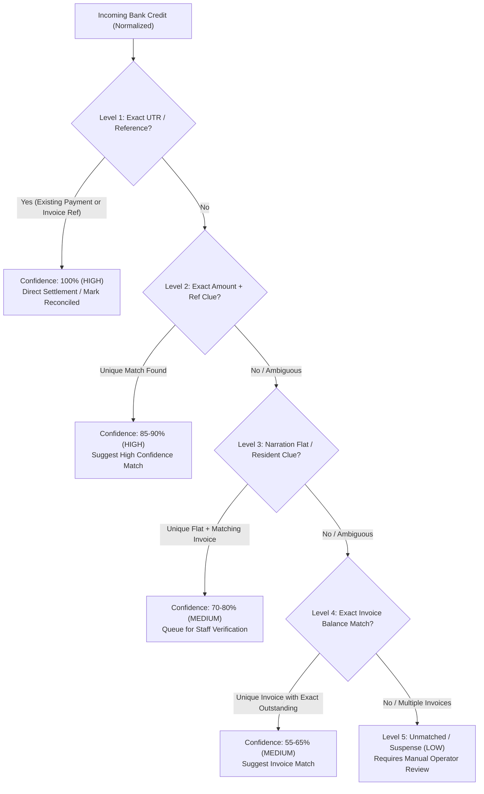
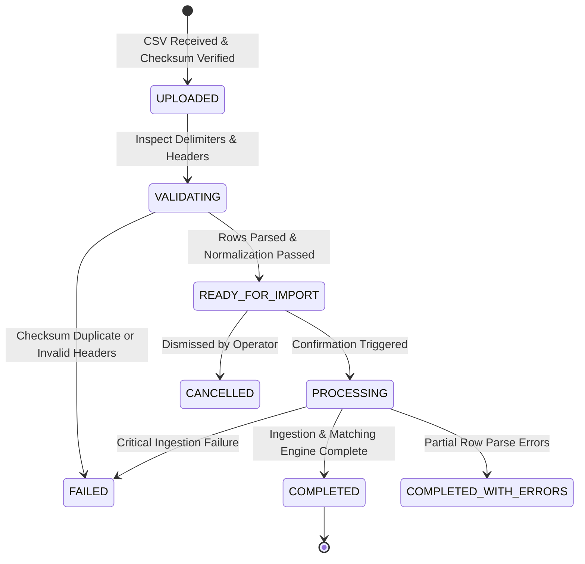
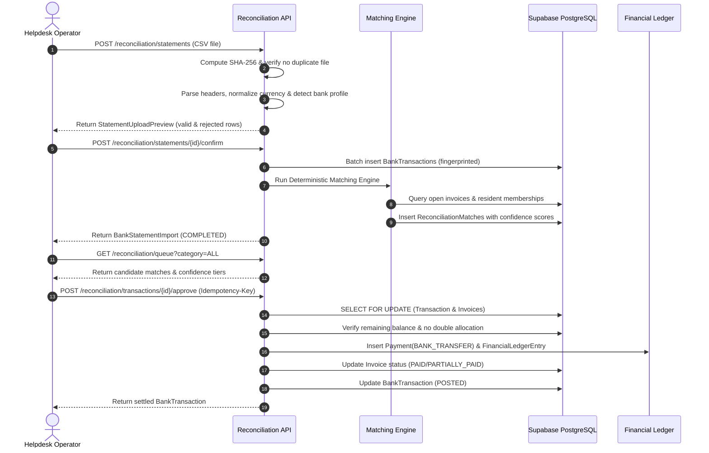
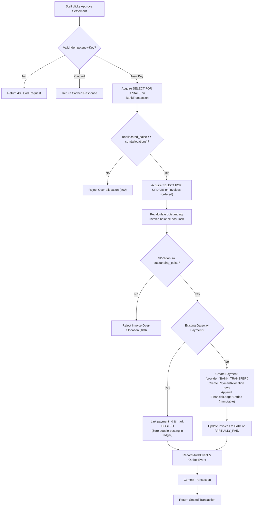
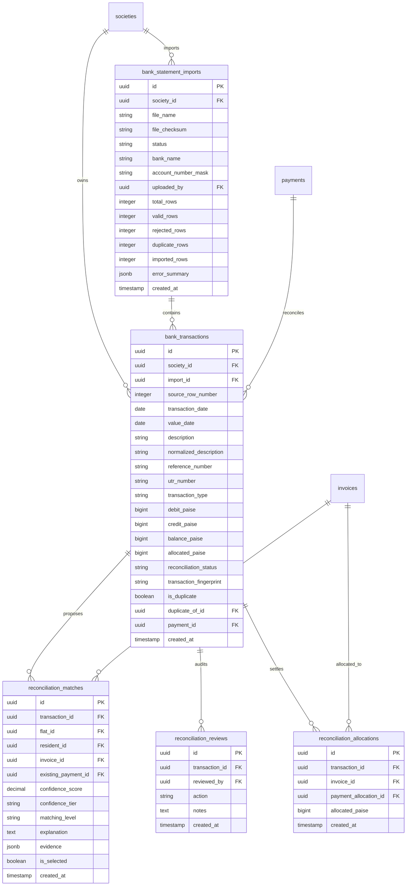

# Bank Statement Reconciliation Architecture Specification

## 1. Overview & Core Philosophy

The **Bank Statement Reconciliation** module in the Isoswe Township Operations Platform automates the ingestion, normalization, deterministic matching, and financial ledger settlement of society bank statements.

In Indian gated communities (e.g. 2,400 apartments across 28 towers), residents frequently pay monthly maintenance dues directly via **NEFT**, **RTGS**, **IMPS**, or **UPI** instead of payment gateways. This produces bulk credit lines on the society's current account that must be matched against outstanding maintenance invoices without manual spreadsheet reconciliation or human bookkeeping errors.

### Guiding Principles

1. **Bank Statement as Evidence, Not Authority**: Ingesting a bank statement line is proof that funds entered the account, but it does **not** grant automatic authorization to alter financial balances until verified or approved.
2. **Deterministic-First Matching**: Matching logic is strictly deterministic and rules-based. Machine learning or fuzzy guessing is never used for financial ledger allocations.
3. **Zero Double-Posting**: Payments collected via online gateway channels already exist in `payments` and `financial_ledger_entries`. Matching against an existing payment marks the transaction `POSTED` without creating duplicate payments or ledger credits.
4. **Row-Level Concurrency & Balance Recalculation**: Every settlement transaction acquires row-level locks (`SELECT FOR UPDATE`) on both the bank transaction and candidate invoices, recalculating remaining balances inside the lock.
5. **Integer Paise Precision**: All monetary values are processed as integer paise (`1 INR = 100 paise`) using `Decimal` conversion. Floating-point arithmetic is strictly prohibited.
6. **Immutable Ledger & Audit Trail**: Direct bank transfers create `Payment` records with provider `BANK_TRANSFER`, paired `PaymentAllocation` rows, and immutable `FinancialLedgerEntry` items (`PAYMENT_RECEIVED`, `PAYMENT_ALLOCATED`).
7. **Strict Multi-Tenancy**: All operations, tables, and indexes are isolated by `society_id`.
8. **Role Integrity**: Restricted to existing platform roles: `HELPDESK` (operator authority) and `RESIDENT` (read-only view of their flat).

---

## 2. Ingestion & Normalization Pipeline

### 2.1 File Validation & Multi-Format Parsing
- **Format**: CSV format (UTF-8, UTF-8 with BOM, max 10MB).
- **Delimiter Sniffing**: Automatically sniffs and supports comma (`,`), semicolon (`;`), and tab (`\t`).
- **Header Normalization**: Strips BOMs, whitespace, case, and punctuation (`date`, `narration`, `chq/ref no`, `withdrawal(dr)`, `deposit(cr)`, `balance`).
- **Bank Profiles**: Auto-detects or accepts bank-specific formats:
  - **HDFC Bank**: Date, Narration, Chq/Ref No, Value Dt, Withdrawal Amt, Deposit Amt, Closing Balance
  - **ICICI Bank**: Transaction Date, Value Date, Cheque No, Transaction Remarks, Debit Amount, Credit Amount, Balance
  - **State Bank of India (SBI)**: Txn Date, Value Date, Description, Ref No./Cheque No., Debit, Credit, Balance
  - **Axis Bank**: Tran Date, Value Date, Particulars, Chq No, Init. Br, Dr Amount, Cr Amount, Bal
  - **Generic / Custom**: Flexible header mapping dictionary (`custom_mapping`).

### 2.2 Three-Tier Duplicate Prevention
1. **File-Level Checksum**: SHA-256 computed on the exact file payload (`file_checksum`). Uploading the identical file twice within a society is rejected immediately with `409 Conflict`.
2. **Transaction Fingerprint**: SHA-256 hash computed deterministically from:
   $$\text{Fingerprint} = \text{SHA256}(\text{society\_id} + \text{date} + \text{type} + \text{paise} + \text{reference} + \text{normalized\_narration})$$
   Enforced by unique index `uq_bank_transactions_society_fingerprint`. Duplicate rows inside or across imports are flagged as `is_duplicate=True` and status `DUPLICATE`, preventing double counting.
3. **Bank UTR Uniqueness**: Extracted Indian banking UTR/RRN numbers are checked against previously settled transactions.

### 2.3 Amount & Narration Normalization
- Amounts are converted to integer paise using `Decimal` string arithmetic:
  $$\text{paise} = \text{int}(\text{Decimal}(s) \times 100)$$
- Empty or zero debit/credit strings are normalized to 0. Rows with both debit and credit equal to 0 are rejected.
- **Credit vs. Debit Separation**:
  - `CREDIT` rows represent incoming resident maintenance receipts and are passed to the matching engine.
  - `DEBIT` rows represent outgoing society vendor or utility expenses. They are imported for complete account reconciliation but are strictly excluded from resident invoice matching.
- **Narration Normalization**:
  - Upper-cased, whitespace collapsed, punctuation stripped.
  - Regex extraction parses Indian transaction identifiers:
    - NEFT UTRs: `^[A-Z]{4}[0-9]{6,16}$`
    - RTGS UTRs: `^[A-Z]{4}R[0-9]{10,16}$`
    - IMPS / UPI RRNs: 12-digit numeric sequences
    - Resident & Tower Clues: Flat identifiers like `T4-1203`, `B-408`, `FLAT 1203`, `TOWER 12 UNIT 302`

---

## 3. Layered Deterministic Matching Engine

The matching engine processes incoming credits against open invoices and resident records across 5 deterministic levels:

### Matching Rules Matrix

| Level | Identification Method | Confidence Tier | Auto-Eligible | Action |
|---|---|---|---|---|
| **Level 1** | Exact Bank UTR matches existing payment `provider_reference` or invoice payment reference | **HIGH (95-100%)** | Yes | Links existing online payment or prepares direct settlement |
| **Level 2** | Exact Amount (`credit_paise == outstanding_paise`) + partial reference or UTR prefix match | **HIGH (85-90%)** | Yes (Review Queue) | Generates candidate match with transparent evidence breakdown |
| **Level 3** | Narration contains unambiguous Tower/Flat number (e.g. `T2-0804`) or resident name | **MEDIUM (70-80%)** | Operator Review | Matches flat and suggests oldest unpaid invoice |
| **Level 4** | Exact single invoice amount match within society without narration clue | **MEDIUM (55-65%)** | Operator Review | Proposes candidate invoice; flags if multiple invoices share amount |
| **Level 5** | Unmatched narration, ambiguous flat matches, or partial payments | **LOW (0-30%)** | Manual Allocation | Placed in Review Queue; staff can search flats or mark as Suspense |

---

## 4. Financial Settlement & Ledger Invariants

### 4.1 Atomic Concurrency Protection
All approval and allocation actions run inside an explicit transaction with pessimistic locking:
1. `SELECT ... FROM bank_transactions WHERE id = :id FOR UPDATE`: Locks transaction record, verifies status is `UNMATCHED`, `SUGGESTED`, or `PENDING_APPROVAL`, and verifies `unallocated_paise >= allocation_sum`.
2. `SELECT ... FROM invoices WHERE id IN (:ids) FOR UPDATE`: Locks candidate invoice rows in order.
3. **Balance Recalculation**: Post-lock query computes:
   $$\text{outstanding} = \text{total\_amount} - \sum \text{successful\_allocations}$$
   If any invoice has been settled in the interim or if $\text{allocation} > \text{outstanding}$, the entire transaction aborts with `HTTP 400 Validation Error`.

### 4.2 Handling Pre-Existing Payments (Zero Double-Posting)
If the bank credit corresponds to a resident payment made via the online payment gateway (e.g. UPI or card):
- The existing `Payment` already recorded `PAYMENT_RECEIVED` and `PAYMENT_ALLOCATED` in `financial_ledger_entries`.
- Creating new ledger entries would result in duplicate revenue and distorted cash balances.
- The reconciliation service links `existing_payment_id`, sets `bank_transaction.reconciliation_status = POSTED`, and marks `bank_transaction.allocated_paise = payment.amount_paise`.
- **Zero additional ledger entries are created.**

### 4.3 Direct Bank Transfer Ledger Settlement
For direct NEFT/RTGS/IMPS credits without a prior online payment record:
1. Creates a `Payment` record with:
   - `provider = 'BANK_TRANSFER'`
   - `provider_reference = bank_transaction.utr_number` (or `TXN-{bank_txn_id}`)
   - `status = PaymentStatus.SUCCESS`
   - `flat_id = target_flat_id`
2. Creates `PaymentAllocation` rows linking the new payment to the target invoice.
3. Creates paired `FinancialLedgerEntry` items:
   - `PAYMENT_RECEIVED`: `credit_paise` credited to Society Bank Account.
   - `PAYMENT_ALLOCATED`: Allocated amount debited to Accounts Receivable and credited to Maintenance Revenue.
4. Marks `bank_transaction.reconciliation_status = POSTED`.
5. Updates invoice status to `PAID` or `PARTIALLY_PAID`.

### 4.4 Multi-Flat Split Invariant
`BillingRepository` strictly enforces that an individual `Payment` belongs to a single flat (`payment.flat_id == invoice.flat_id`).
When an operator approves a bulk corporate or multi-unit credit split across invoices of different flats:
- The service groups allocations by `flat_id`.
- Creates a dedicated `Payment` record per flat with unique reference suffix `-{flat_id[-6:]}`.
- Maintains atomic ledger integrity without violating cross-flat billing constraints.

---

## 5. Security & Formula Injection Defense

### 5.1 CSV Formula Injection Protection
When generating reconciliation CSV export reports, cells starting with spreadsheet calculation triggers (`=`, `+`, `-`, `@`, `\t`, `\r`) are sanitized by prepending a single quote (`'`). This neutralizes DDE (Dynamic Data Exchange) and formula injection exploits when financial auditors open reports in Microsoft Excel or Google Sheets.

### 5.2 Mandatory Idempotency-Key
All state-modifying financial approvals require a unique `Idempotency-Key` header. Duplicate submissions within 24 hours return the cached response without re-executing ledger modifications.

---

## 6. Architecture & Workflow Diagrams

### 6.1 Statement Import Lifecycle State Diagram

### 6.2 Deterministic Matching & Review Sequence Diagram

### 6.3 Financial Approval & Ledger Posting Flowchart

### 6.4 Database Schema ER Diagram

---

## 7. API Endpoints Reference

All endpoints require JWT bearer authentication and role `HELPDESK` (enforced via `require_roles("HELPDESK")`).

| Endpoint | Method | Description |
|---|---|---|
| `/api/v1/reconciliation/statements` | `POST` | Upload CSV bank statement; returns parsed validation preview |
| `/api/v1/reconciliation/statements` | `GET` | List previous statement imports with status & row counts |
| `/api/v1/reconciliation/statements/{id}/confirm` | `POST` | Commit parsed statement and execute deterministic matching |
| `/api/v1/reconciliation/statements/{id}/cancel` | `POST` | Discard unconfirmed statement import |
| `/api/v1/reconciliation/transactions` | `GET` | Filter normalized transactions by status, type, or search |
| `/api/v1/reconciliation/transactions/{id}` | `GET` | Fetch single transaction with candidate matches and history |
| `/api/v1/reconciliation/queue` | `GET` | Fetch manual review queue filtered by category |
| `/api/v1/reconciliation/transactions/{id}/suggest` | `POST` | Suggest manual match with flat and invoice |
| `/api/v1/reconciliation/transactions/{id}/approve` | `POST` | Atomic financial ledger settlement (requires `Idempotency-Key`) |
| `/api/v1/reconciliation/transactions/{id}/reject` | `POST` | Reject suggested match and return transaction to unmatched |
| `/api/v1/reconciliation/transactions/{id}/mark-unidentified` | `POST` | Move mystery credit to suspense account |
| `/api/v1/reconciliation/summary` | `GET` | Retrieve society-wide reconciliation KPIs and ratios |
| `/api/v1/reconciliation/reports/export` | `GET` | Download sanitized CSV reconciliation report |

