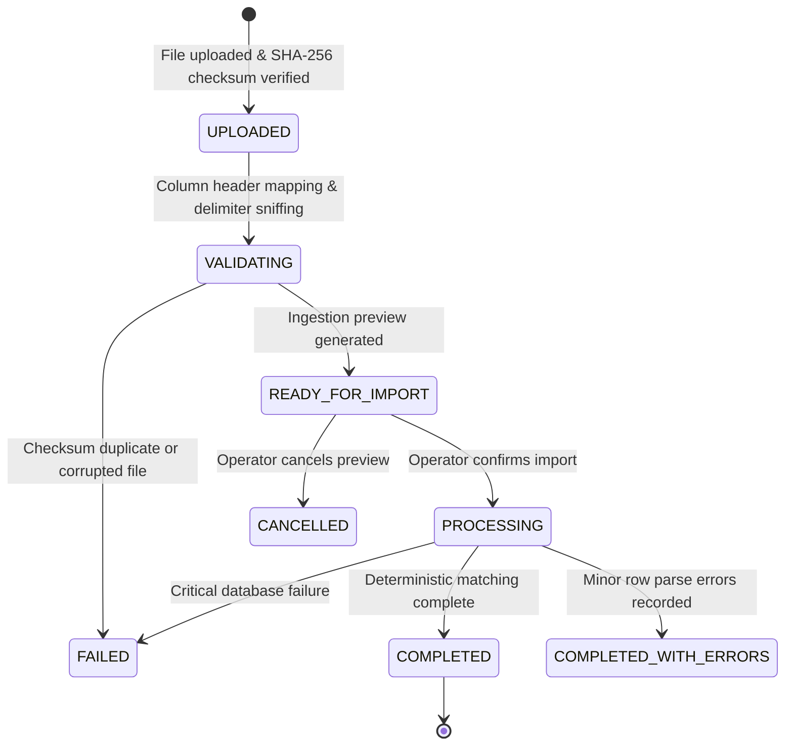
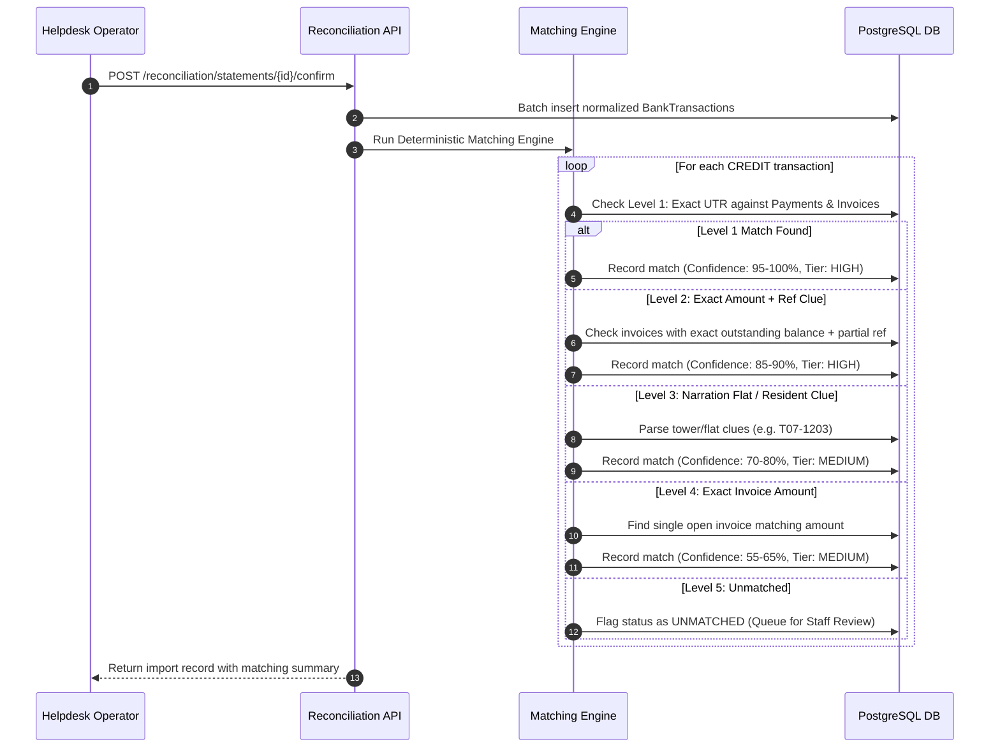
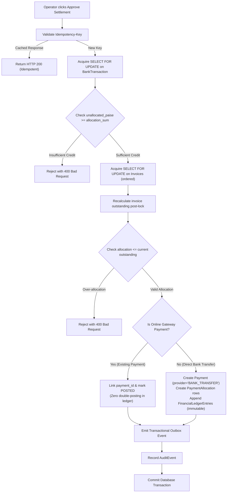
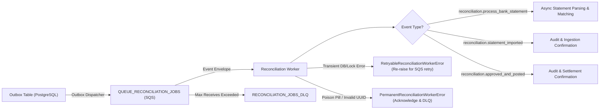

# Bank Statement Reconciliation Operations & Engineering Guide

## 1. Domain Model Reference

The Reconciliation domain operates 5 authoritative entities within Supabase PostgreSQL, strictly isolated by `society_id`:

1. **`BankStatementImport`**: Ingested bank statement file metadata, SHA-256 checksum, parsed row metrics, bank profile, and lifecycle state.
2. **`BankTransaction`**: Individual statement line item normalized to integer paise (`debit_paise`, `credit_paise`, `balance_paise`), reconciliation status, UTR reference, and SHA-256 fingerprint.
3. **`ReconciliationMatch`**: Candidate match between a bank transaction and open maintenance invoices or existing online gateway payments with explainable confidence scoring (HIGH, MEDIUM, LOW) and structured evidence JSON.
4. **`ReconciliationAllocation`**: Direct ledger linkage between an approved bank credit and an invoice outstanding balance.
5. **`ReconciliationReview`**: Immutable audit record of helpdesk review actions (`SUGGESTED`, `APPROVED`, `REJECTED`, `UNIDENTIFIED`) capturing staff ID and rationale notes.

---

## 2. Statement Import Lifecycle & CSV Mapping

### Lifecycle State Machine


### Supported CSV Column Mappings

| Standard Field | HDFC Profile | ICICI Profile | SBI Profile | Axis Profile |
|---|---|---|---|---|
| **Date** | `Date` / `Txn Date` | `Transaction Date` | `Txn Date` | `Tran Date` |
| **Value Date** | `Value Dt` | `Value Date` | `Value Date` | `Value Date` |
| **Narration** | `Narration` | `Transaction Remarks` | `Description` | `Particulars` |
| **Reference / UTR** | `Chq/Ref No` | `Cheque No` / `Ref No` | `Ref No./Cheque No.` | `Chq No` |
| **Withdrawal (Debit)** | `Withdrawal Amt` | `Debit Amount` | `Debit` | `Dr Amount` |
| **Deposit (Credit)** | `Deposit Amt` | `Credit Amount` | `Credit` | `Cr Amount` |
| **Closing Balance** | `Closing Balance` | `Balance` | `Balance` | `Bal` |

*Custom Mappings*: Operators can pass a `custom_mapping` JSON dictionary to dynamically bind non-standard bank export headers.

---

## 3. Matching Rules & Weighting Algorithm



### Evidence Scoring Weighting

$$\text{Confidence Score} = w_{\text{UTR}} \cdot E_{\text{UTR}} + w_{\text{amount}} \cdot E_{\text{amount}} + w_{\text{resident}} \cdot E_{\text{resident}} + w_{\text{date}} \cdot E_{\text{date}}$$

- **Exact UTR match** ($w = 60$): Exact match with existing payment reference or invoice payment code.
- **Exact amount match** ($w = 20$): Bank credit equals current invoice outstanding balance.
- **Resident/Flat match** ($w = 10$): Narration contains verified tower/unit number or resident name.
- **Date proximity** ($w = 10$): Transaction date within billing cycle due window.

---

## 4. Financial Settlement & Concurrency Protection



---

## 5. Background Processing & SQS Queue Architecture



### Worker Reliability Invariants
1. **Idempotency**: Processing checks current database status (`imp.status == COMPLETED` or `txn.reconciliation_status == POSTED`) before doing work; duplicates are safely skipped.
2. **Short DB Transactions**: DB locks are released immediately; heavy parsing and matching are staged outside long-running lock windows.
3. **Bounded Retries**: SQS redrive policy caps retries at 3 attempts with exponential backoff before sending failed jobs to the Dead Letter Queue (`QUEUE_RECONCILIATION_JOBS_DLQ`).
4. **Audit Logging**: Every worker execution produces an `AuditEvent` with the original `correlation_id` from the triggering client request.

---

## 6. Security & Formula Injection Defense

1. **Spreadsheet Formula Injection Defense**: When generating CSV exports (`/api/v1/reconciliation/reports/export`), values starting with `=`, `+`, `-`, or `@` are automatically prepended with a single quote (`'`). This prevents malicious spreadsheet command execution in Microsoft Excel or Google Sheets.
2. **Row-Level Security (RLS)**: PostgreSQL tables `bank_statement_imports`, `bank_transactions`, `reconciliation_matches`, `reconciliation_allocations`, and `reconciliation_reviews` enforce tenant isolation by `society_id`.
3. **Role Authorization**: All reconciliation mutations require role `HELPDESK`. Direct financial mutations by `RESIDENT` role tokens are strictly rejected with `HTTP 403 Forbidden`.

---

## 7. Operational Troubleshooting & Runbooks

### Issue 1: "File already imported in this society" (`409 Conflict`)
- **Cause**: The SHA-256 checksum of the uploaded file matches an existing record in `bank_statement_imports`.
- **Resolution**: Check the statement history in the Overview tab. If the statement was uploaded previously, review existing transactions rather than re-uploading. If a new monthly statement has identical contents, verify with the bank.

### Issue 2: Transactions Flagged as `DUPLICATE`
- **Cause**: The SHA-256 fingerprint `(society_id + date + type + paise + ref + narration)` matches an existing transaction.
- **Resolution**: This is normal when overlapping statement date ranges are uploaded. Duplicate transactions are marked `is_duplicate = True` and excluded from matching to prevent double-counting.

### Issue 3: Invoice Over-Allocation Rejected (`400 Bad Request`)
- **Cause**: The target invoice received a payment through another channel (e.g. resident paid online) between the time the suggestion was generated and the operator clicked approve.
- **Resolution**: The pessimistic lock detected that `allocation > current_outstanding`. Refresh the review queue; the updated invoice balance will be reflected.

### Issue 4: Poison Message in SQS DLQ
- **Cause**: Malformed payload or unresolvable society ID in event envelope.
- **Resolution**: Inspect the message in AWS SQS Console under `township-ops-reconciliation-jobs-dlq`. Check `correlation_id` in CloudWatch structured JSON logs:
  ```json
  {"action": "reconciliation.process_bank_statement.processed", "resource_type": "Reconciliation"}
  ```
